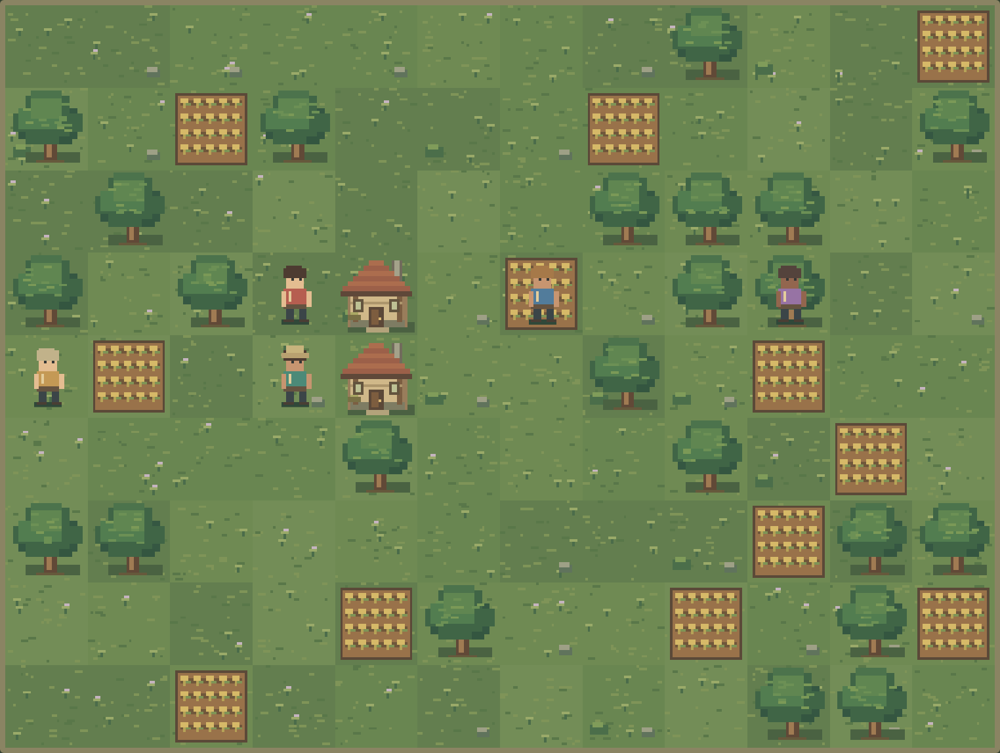
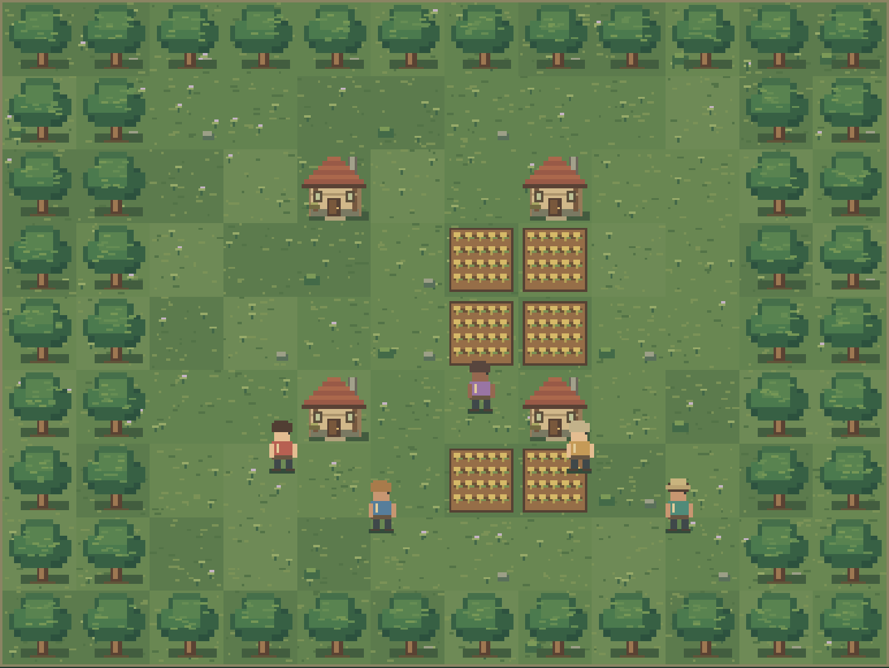
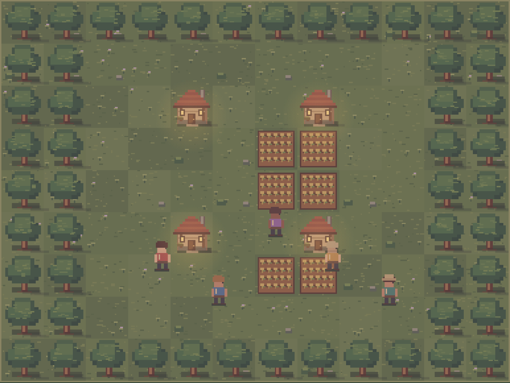
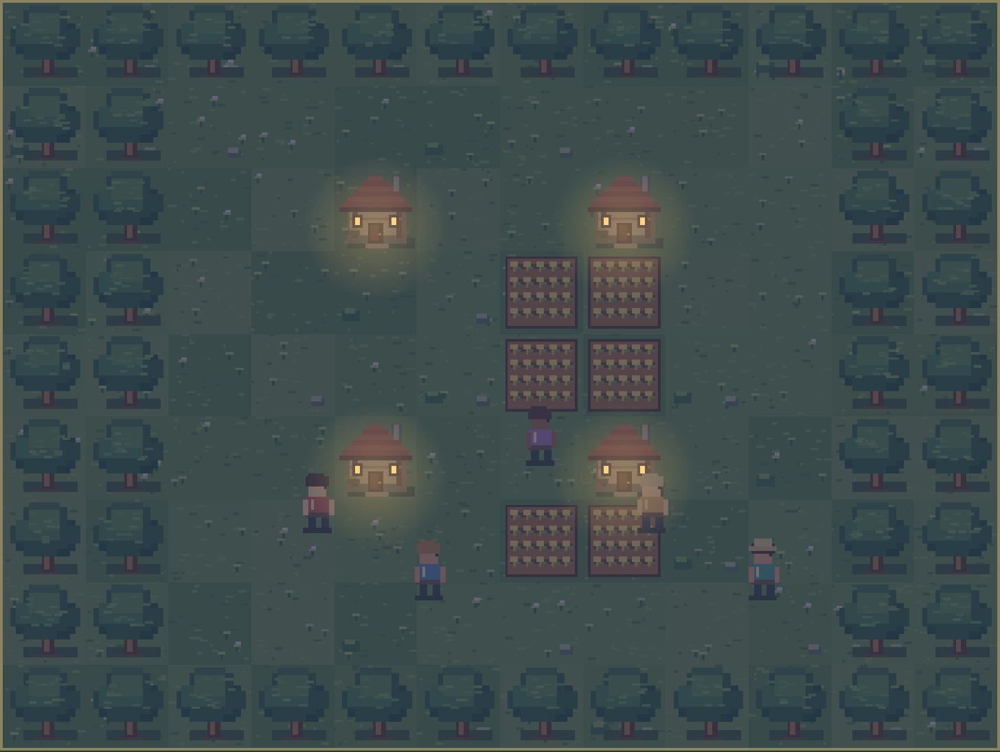

# Microcosme v0.9 — Direction artistique

Un village fantasy naturaliste vu de dessus : prairie ponctuée de fleurs, forêt feuillue, petites maisons de bois et de torchis, champs dorés. La géométrie reste lisible ; les cinq terrains visuels reposent sur les quatre types existants (les variantes de prairie ne sont pas de nouveaux terrains).

## Palette

| Usage | Couleurs principales |
| --- | --- |
| Prairie | `#59794b`, `#60824e`, `#668650`, `#6b8954` |
| Mousse / herbes | `#82965c`, `#95a968`, `#3f6546` |
| Feuillage | `#284f3d`, `#335e42`, `#56824e`, `#739654` |
| Terre / bois | `#79583e`, `#684735`, `#946c46` |
| Pierre / enduit | `#9a9e87`, `#d0b88a` |
| Toit / lumière | `#a9664a`, `#ffcb78` |
| Nuit | voile `#22284c`, maximum 58 % |

## Fabrication

Toutes les ressources sont originales et dessinées par les instructions Canvas de `graphics.js`. Aucun téléchargement, dessin manuel, modèle externe ou service d'images. Les coordonnées entières définissent des pixels de la grille logique ; les halos lumineux sont la seule exception au dessin à bords francs.

Une case mesure 32 × 32 pixels. Le hachage de l'indice et d'un sel donne les variations de teinte, brins, fleurs, pierres, buissons et feuilles. Le décor reste identique après chaque rafraîchissement et rechargement d'une même carte. Aucun accès au hasard du moteur. Les dessins restent dans leur case.

Les habitants utilisent un modèle de 16 × 24 pixels, trois poses et quatre orientations. Leurs vêtements, cheveux, teints et chapeaux dépendent de l'identité, avec des combinaisons distinctes pour les 30 premières identités. La marche alterne jambes et bras ; l'attente comporte un mouvement d'un pixel. Un anneau ambré distingue la sélection. Tous les habitants passent devant le décor pour préserver leur visibilité. Les boutons conservent leurs noms accessibles.

## Lumière et ambiance

Matin frais, jour clair, crépuscule chaud avec ombres étirées suggérées, nuit bleutée avec fenêtres et halos ambrés. Les coefficients sont interpolés entre plusieurs heures de référence ; dans la partie, l'heure entière du moteur reste la seule source de lumière. La simulation avançant par heures, la variation visible se fait par pas horaires, sans fondu autonome après une pause.

Feuillage discret, fumée, poussières diurnes et lucioles nocturnes : un nombre limité de marques Canvas. La préférence système de mouvement réduit désactive ces animations et la marche ; les lumières restent visibles.

## Aperçus

Le village réel conserve la disposition de la partie ; l'atelier présente un village de composition fixe.

