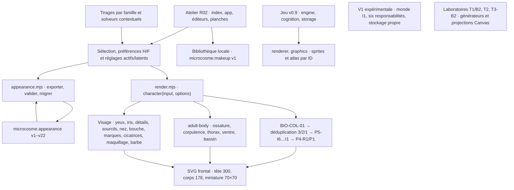

# Microcosme · BIO-CONVERGENCE-01-R01

Audit du 27 novembre 2026

## Conclusion

L’atelier BIO-CORPS-06-R02 est opérationnel pour composer et relire des apparences adultes. Son compositeur SVG et ses solveurs sont utilisables sans DOM. **La convergence est partielle**. L’atelier sait dessiner une apparence fournie et tirer plusieurs familles de traits, mais le dépôt ne fournit ni génération complète d’un habitant à partir d’une graine, ni contrat commun avec les sauvegardes et l’identité du monde. Les réglages corporels de l’autre base H/F survivent dans la session pendant l’édition et sortent du périmètre de l’archive complète. La preview conserve les six commandes F et les cinq commandes H et les rend accessibles au toucher simulé.

L’ordre recommandé est de faire arbitrer l’état à conserver et le périmètre du premier consommateur, puis de traiter les écarts qui empêchent un aller-retour autonome de l’adulte. Une fois ce socle prouvé, contractualiser les âges et évaluer une tranche de jeu bornée. Les choix esthétiques adultes validés servent de références de non-régression.

## Révisions et portée des preuves

| Source | Révision et usage |
| --- | --- |
| Base documentaire | `docs/bio-convergence-01-r01` à `ebff2c51ce50cec2ef481634db1c24f84f86a916`. Le seul diff avec la tête de la branche atelier est le contrat de cet audit. [Contrat](CONTRAT.md) · [Comparaison](https://github.com/Thsethse/Microcosme/compare/c18aa4d54873f19186d6c1af7e17aa22e566dda1...ebff2c51ce50cec2ef481634db1c24f84f86a916) |
| Atelier validé | `codex/bio-corps-06-r02` à `c18aa4d54873f19186d6c1af7e17aa22e566dda1`. Le manifeste épingle la source `86fb73f54ab5801b00c7b9511797366478daba38`. Entre cette source et la base d’audit, seuls le rapport de recette R02 et le contrat changent. L’HTML public et le bundle `atelier-72b2fd02e5cb452f.js` concordent avec les SHA-256 déclarés. Bundle de 636 298 octets, SHA-256 `72b2fd02e5cb452fa5ac3074c5997ba0a7c72f1772d33481b669a4c630facf93`. Le build active notamment `data-natural-eyes`. [Manifeste](https://thsethse.github.io/Microcosme/preview/bio-corps-06-r02/version.json) · [Build R02](https://github.com/Thsethse/Microcosme/blob/ebff2c51ce50cec2ef481634db1c24f84f86a916/bio-yeux-01/build-pubic-stipple-preview.mjs#L1-L19) · [Recette R02](https://github.com/Thsethse/Microcosme/blob/ebff2c51ce50cec2ef481634db1c24f84f86a916/docs/ai/bio-corps-06-r02/RAPPORT.md#L13-L27) |
| Jeu v0.9 | Modules à la racine au SHA de base, `package.json` v0.9.0. Le `main` observé à `8dccad95fa0b6f64c48ca97b06e72f61762e23cc` publie la preview statique séparément. [Version du jeu](https://github.com/Thsethse/Microcosme/blob/ebff2c51ce50cec2ef481634db1c24f84f86a916/package.json#L1-L13) · [Commit Pages](https://github.com/Thsethse/Microcosme/commit/8dccad95fa0b6f64c48ca97b06e72f61762e23cc) |
| Autres références | Prototypes Canvas BIO-GEN T1/B2, T2 et BIO-STRUCT T3-B2 dans le checkout d’audit. Contrat conceptuel BIO-CORPS à `fdc0654d98ea7bff74559f5c5408990583f5a916`, architecture J3 à `b604453d3d3634e2c2abd95847c957c3f5449391`, tranche expérimentale V1 à `205c7a5f515f45f3a58ca14e41efc12714ae5365`. [Transmission](https://github.com/Thsethse/Microcosme/blob/fdc0654d98ea7bff74559f5c5408990583f5a916/docs/bio-gen-t1/BIO-CORPS_CONTRAT.md) · [J3](https://github.com/Thsethse/Microcosme/blob/b604453d3d3634e2c2abd95847c957c3f5449391/docs/ai/J3_ARCHITECTURE_MOTEURS_UNIVERSELS_v1.0.md#L7-L29) · [V1](https://github.com/Thsethse/Microcosme/blob/205c7a5f515f45f3a58ca14e41efc12714ae5365/docs/V1-SIX-MOTEURS.md#L35-L54) |

**Vérifié** désigne une lecture précise du code ou un contrôle effectivement exécuté. Les résultats repris d’une recette antérieure sont signalés comme historiques. **Inféré** indique une conséquence ou une proposition dérivée des sources. **Non vérifié** indique une donnée ou un comportement pour lequel les éléments manquent. Les mesures et diagnostics ponctuels ont utilisé des fichiers temporaires hors du dépôt. Les références aux axes C1–C6 de l’audit sont distinctes des domaines conceptuels C1–C6 cités dans J3.

## C1 · Architecture — Partiel

**Le rendu est unifié.** `character(input, options)` produit un SVG frontal en chaîne JavaScript sous Node ou navigateur. `restoreSelection`, `characterInput`, `appearanceDocument` et `parseAppearance` se chargent sans DOM. Ils constituent des points d’entrée réutilisables. Le rendu requiert néanmoins un assemblage de l’état de sélection, des réglages faciaux, de la palette et de la politique de rendu. En production, `app.mjs::svg` effectue cet assemblage, active les finitions, donne un identifiant d’instance et remplace le `viewBox`. L’appel direct avec ses seuls défauts peut omettre les reliefs, le fini du ventre, le tracé pelvien ou le contour naturel de la preview. [Rendu](https://github.com/Thsethse/Microcosme/blob/ebff2c51ce50cec2ef481634db1c24f84f86a916/bio-yeux-01/render.mjs#L19-L25) · [Compositeur](https://github.com/Thsethse/Microcosme/blob/ebff2c51ce50cec2ef481634db1c24f84f86a916/bio-yeux-01/render.mjs#L84-L150) · [Adaptation atelier](https://github.com/Thsethse/Microcosme/blob/ebff2c51ce50cec2ef481634db1c24f84f86a916/bio-yeux-01/app.mjs#L91-L112) · [Archive](https://github.com/Thsethse/Microcosme/blob/ebff2c51ce50cec2ef481634db1c24f84f86a916/bio-yeux-01/appearance.mjs#L66-L83)

### Carte d’architecture

| Frontière | Carte des appels et des données |
| --- | --- |
| Interface et état | `app.mjs::setSelection` puis `refreshCharacter`. `*-editor.mjs` portent l’intention de chaque famille, les latences et certains contextes de solveurs. `*-study.mjs` portent les planches, les cadrages et les références. Le changement de sélection peut demander une confirmation si l’effectif des yeux change. [État et confirmation](https://github.com/Thsethse/Microcosme/blob/ebff2c51ce50cec2ef481634db1c24f84f86a916/bio-yeux-01/app.mjs#L373-L380) · [Cycle UI](https://github.com/Thsethse/Microcosme/blob/ebff2c51ce50cec2ef481634db1c24f84f86a916/bio-yeux-01/app.mjs#L480-L516) · [Montage des éditeurs](https://github.com/Thsethse/Microcosme/blob/ebff2c51ce50cec2ef481634db1c24f84f86a916/bio-yeux-01/app.mjs#L813-L853) |
| Héritage capillaire et facial | BIO-COL appelle la chaîne de déduplication et remplace les couleurs admises après production du SVG. P5-I6 délègue vers les lots précédents ou adapte un gabarit de base. P4-R1 calcule le contour, les ancres et le passage des cheveux. Les arrangements G/D/U concernent la coiffure frontale. [BIO-COL](https://github.com/Thsethse/Microcosme/blob/ebff2c51ce50cec2ef481634db1c24f84f86a916/bio-col-01/render.mjs#L1-L11) · [P5-I6](https://github.com/Thsethse/Microcosme/blob/ebff2c51ce50cec2ef481634db1c24f84f86a916/preview/bio-vis-p5-i6/model.mjs#L1-L18) · [Déduplication](https://github.com/Thsethse/Microcosme/blob/ebff2c51ce50cec2ef481634db1c24f84f86a916/preview/bio-vis-dedup-lot-3/render.mjs#L1-L14) · [Repères](https://github.com/Thsethse/Microcosme/blob/ebff2c51ce50cec2ef481634db1c24f84f86a916/preview/bio-vis-p5-i6/i5/i4/i3/i2/i1/base/r1/model.mjs#L31-L50) |
| Corps et visage | Corps adulte substitué au groupe hérité à partir du menton. Volumes et détails de surface dérivent de la géométrie et de ses marges. Le nez utilise les zones des yeux, leurs détails et l’intention de bouche. La bouche est ensuite résolue avec l’enveloppe nasale. Le compositeur place marques, cicatrices, maquillage et barbe dans cet ordre, avec les masques et les couches capillaires hérités. [Orchestration](https://github.com/Thsethse/Microcosme/blob/ebff2c51ce50cec2ef481634db1c24f84f86a916/bio-yeux-01/render.mjs#L84-L147) · [Géométrie et ordre du corps](https://github.com/Thsethse/Microcosme/blob/ebff2c51ce50cec2ef481634db1c24f84f86a916/bio-yeux-01/adult-body.mjs#L100-L195) |
| Contraintes et persistance | Le sérialiseur recalculant les valeurs effectives s’appuie sur plusieurs des mêmes solveurs que le rendu. Les deux chemins assemblent certaines entrées séparément, dont la géométrie du visage et l’analyse du SVG déjà peint. Les contraintes combinées doivent donc être contrôlées sur l’interface d’appel et au rejeu. Le remplacement par motifs textuels et la détection des groupes SVG constituent des dépendances à la structure du rendu hérité. [Validation d’archive](https://github.com/Thsethse/Microcosme/blob/ebff2c51ce50cec2ef481634db1c24f84f86a916/bio-yeux-01/appearance.mjs#L78-L165) · [Réécriture du SVG](https://github.com/Thsethse/Microcosme/blob/ebff2c51ce50cec2ef481634db1c24f84f86a916/bio-yeux-01/render.mjs#L90-L149) |
| Frontières de simulation | Le jeu v0.9 produit des sprites via un atlas par `p.id`, avec mouvements et lumière. T1/B2 a son modèle `generate/derive` et ses archives. T2 et T3-B2 ont leurs propres profils, vues et géométries. T3-B2 expose notamment `generateBodyB2`, `validateBody`, `serializeBody` et `parseBody`. Aucun adaptateur v22 ↔ Canvas ou v22 ↔ jeu n’a été identifié dans ces points d’entrée. [Jeu](https://github.com/Thsethse/Microcosme/blob/ebff2c51ce50cec2ef481634db1c24f84f86a916/renderer.js#L1-L33) · [T1-B2](https://github.com/Thsethse/Microcosme/blob/ebff2c51ce50cec2ef481634db1c24f84f86a916/preview/bio-gen-t1-b2/model.js#L22-L57) · [T2](https://github.com/Thsethse/Microcosme/blob/ebff2c51ce50cec2ef481634db1c24f84f86a916/preview/bio-gen-t2/README.md) · [T3-B2](https://github.com/Thsethse/Microcosme/blob/ebff2c51ce50cec2ef481634db1c24f84f86a916/preview/bio-struct-t3-b2/canonical-body.js#L87-L145) |

**Limite et recommandation.** Les modules réunissent un compositeur graphique et des générateurs locaux. La génération d’un habitant unifié reste absente. Après arbitrage, documenter une entrée stable qui prend un état d’apparence validé et les options d’échelle, avec des tests d’équivalence aux témoins de l’atelier. Un consommateur affichant plusieurs SVG doit donner des instances distinctes pour isoler les identifiants de clip, masque et gradient. Les entrées historiques et leurs aliases font partie de cette dépendance. [Identifiants et contraintes de rendu](https://github.com/Thsethse/Microcosme/blob/ebff2c51ce50cec2ef481634db1c24f84f86a916/bio-yeux-01/render.mjs#L19-L25) · [Catalogue compatible](https://github.com/Thsethse/Microcosme/blob/ebff2c51ce50cec2ef481634db1c24f84f86a916/bio-yeux-01/catalogue.mjs#L12-L44)

## C2 · Données — Partiel

### Inventaire des valeurs

Les valeurs ci-dessous sont nominales. Le nombre entre parenthèses est la référence au passage en mode personnalisé, y compris quand le réglage est latent. L’ouverture de l’atelier utilise `p5-038:G`, corps `standard`, morphologie neutre, yeux historiques et teinte mémorisée `chatain-clair`. Un réglage absent du JSON peut prendre une valeur de référence au rendu ou laisser un calque désactivé. Les pourcentages portent sur des références graphiques. [Initialisation](https://github.com/Thsethse/Microcosme/blob/ebff2c51ce50cec2ef481634db1c24f84f86a916/bio-yeux-01/app.mjs#L43-L66) · [Versions et état actif](https://github.com/Thsethse/Microcosme/blob/ebff2c51ce50cec2ef481634db1c24f84f86a916/bio-yeux-01/appearance.mjs#L166-L211)

| Famille | Champs, domaines et valeurs de référence | Domaines effectifs et dépendances |
| --- | --- | --- |
| Silhouette et composition héritées | Six clés `standard, slim, broad, narrow, shoulders, bust` et deux bases distinctes `adult-h, adult-f`. Valeur initiale `standard`. `body` actif séparé du corps historique dans les archives adultes. | Presets discrets pour l’historique. H/F ouvrent les commandes d’adulte. T existe comme catégorie de pilosité et dans T3-B2, sans base adulte T dans R02. [Corps historiques](https://github.com/Thsethse/Microcosme/blob/ebff2c51ce50cec2ef481634db1c24f84f86a916/preview/bio-vis-p5-i6/i5/i4/i3/i2/i1/base/catalogue.mjs#L27-L34) · [Bases](https://github.com/Thsethse/Microcosme/blob/ebff2c51ce50cec2ef481634db1c24f84f86a916/bio-yeux-01/adult-body.mjs#L1-L33) · [Sélection](https://github.com/Thsethse/Microcosme/blob/ebff2c51ce50cec2ef481634db1c24f84f86a916/bio-yeux-01/catalogue.mjs#L22-L36) |
| Morphologie de tête | Multiplicateurs `skull_width` 0,86–1,18, `skull_height` 0,88–1,18, `forehead_width` 0,88–1,14, `forehead_height` 0,84–1,18, `temple_width` 0,90–1,16, `cheek_width` 0,88–1,22, `jowls` 0,75–1,35, `jaw_width` 0,82–1,22. Neutres 1, pas UI 0,01. Presets neutre, allongé, large et témoins combinés. | Normalisation par bornes. Les ancres yeux, nez, bouche, menton et cheveux dépendent des dimensions. Le curseur d’implantation s’inactive selon la coiffure. Oreilles et ancrages dérivés, sans axe d’oreille ni état d’expression propre. [Paramètres et ancres](https://github.com/Thsethse/Microcosme/blob/ebff2c51ce50cec2ef481634db1c24f84f86a916/preview/bio-vis-p5-i6/i5/i4/i3/i2/i1/base/r1/model.mjs#L4-L50) · [Interface](https://github.com/Thsethse/Microcosme/blob/ebff2c51ce50cec2ef481634db1c24f84f86a916/bio-yeux-01/app.mjs#L571-L577) |
| Cheveux | `style`, `arrangement` G/D/U, 126 références historiques et 119 ordinaires. `options` comprend `accessories`, `contrast` (vrais par défaut) et `monochrome` (faux). `palette` contient une clé parmi 26 (14 naturelles, 12 fantaisie) et le mode historique/aplat. | Disponibilité par effet de rendu, alias historiques conservés, calques protégés et palette indépendante du preset. Densité, longueur, implantation et texture sont principalement des propriétés de gabarit, avec seul axe explicite d’implantation dans la morphologie. Monochrome et options peuvent neutraliser des calques ou des sous-paramètres. [Catalogue](https://github.com/Thsethse/Microcosme/blob/ebff2c51ce50cec2ef481634db1c24f84f86a916/bio-yeux-01/catalogue.mjs#L12-L44) · [Palette](https://github.com/Thsethse/Microcosme/blob/ebff2c51ce50cec2ef481634db1c24f84f86a916/bio-col-01/palette.mjs#L1-L29) · [Disponibilité](https://github.com/Thsethse/Microcosme/blob/ebff2c51ce50cec2ef481634db1c24f84f86a916/bio-yeux-01/availability.mjs#L4-L20) |
| Ouverture des yeux | `width` 75–120 (100), `height` 40–130 (100), `upper` 50–150 (100), `lower` 30–140 (100), `tilt` −12–12° (0), `taper` 0–100 (48), `upperPeak/lowerPeak` −20–20 (0). Huit presets, extrêmes, historique et personnalisé. | Enveloppe liée au contour, coupure médiane, nez, sourcils, bouche, rapport hauteur/largeur. Domaines disjoints possibles. Les valeurs effectives peuvent être fractionnaires et sont archivées avec demandes, forme et graine/version si tirage. [Axes et enveloppe](https://github.com/Thsethse/Microcosme/blob/ebff2c51ce50cec2ef481634db1c24f84f86a916/bio-yeux-01/eyes.mjs#L4-L74) · [Solveur](https://github.com/Thsethse/Microcosme/blob/ebff2c51ce50cec2ef481634db1c24f84f86a916/bio-yeux-01/eyes.mjs#L111-L165) · [Domaines UI](https://github.com/Thsethse/Microcosme/blob/ebff2c51ce50cec2ef481634db1c24f84f86a916/bio-yeux-01/eye-domain.mjs) |
| Iris et pupilles | `irisSize` 60–140 (100), `irisRatio` 0,75–1,25 (1), `pupilSize` 15–80 (45), `outline` 0–10 (5), `secondarySize` 0–80 (50). 16 teintes, primaire noisette et secondaire bleu. Six formes de pupille (cercle par défaut) et hétérochromie aucune, complète ou centrale (aucune). | Pupille ajustée à l’iris, coupes par l’ouverture, anneau secondaire soumis à visibilité, champs secondaires inactifs selon le mode. [Iris](https://github.com/Thsethse/Microcosme/blob/ebff2c51ce50cec2ef481634db1c24f84f86a916/bio-yeux-01/iris.mjs#L8-L49) · [Solveur et tirage](https://github.com/Thsethse/Microcosme/blob/ebff2c51ce50cec2ef481634db1c24f84f86a916/bio-yeux-01/iris.mjs#L139-L208) |
| Paupières, cils, cernes, contours | `upper/lower` plis par côté avec `count` 0–2 (1/0), `distance` 0–100 (34), `length` 20–100 (76), `curve` 0–100 (36), `thickness` 10–100 (33), `intensity` 0–100 (42). `lashes` compte 0–3 (1), longueur 5–15 (8), espacement 0–100 (48). `shadows` intensité 0–100 (0), largeur 30–100 (68), hauteur 10–100 (46), volume 0–100 (0), largeur de poche 30–100 (67). `contours.upper/lower` 50–250 (115) et 50–200 (74). | Contours ajustés à l’ouverture, cils et plis limités par les marges et leur voisinage, valeurs latentes si support absent. La preview active le contour naturel. [Axes](https://github.com/Thsethse/Microcosme/blob/ebff2c51ce50cec2ef481634db1c24f84f86a916/bio-yeux-01/details.mjs#L6-L55) · [Domaines effectifs](https://github.com/Thsethse/Microcosme/blob/ebff2c51ce50cec2ef481634db1c24f84f86a916/bio-yeux-01/details.mjs#L255-L281) |
| Sourcils | `length` 50–125 (100), `thickness` 20–220 (100), `arc` 0–100 (35), `summit` 20–80 (60), `tilt` −20–20° (0), `angularity` 0–100 (20), `height` 0–100 (50), `taper` 0–100 (65), `spacing` 0–100 (50). Booléens absence, monosourcil, fente, faux par défaut. Neuf presets. Pigment lié, assombri ou indépendant (lié, brun chocolat en réserve). | Limites du front et des yeux. Absence rend les autres champs inactifs. Arc nul désactive sommet et angularité. Lien aux cheveux visibles ou à leur teinte mémorisée. [Axes et valeurs](https://github.com/Thsethse/Microcosme/blob/ebff2c51ce50cec2ef481634db1c24f84f86a916/bio-yeux-01/brows.mjs#L9-L57) · [Solveur](https://github.com/Thsethse/Microcosme/blob/ebff2c51ce50cec2ef481634db1c24f84f86a916/bio-yeux-01/brows.mjs#L165-L197) |
| Bouche | `width` 60–130 (100), `upper/lower` 0–200 (100/100), `cupid` 0–100 (45), `peaks` 15–55 (35), `corners/curvature` −100–100 (0/0), `intensity` 0–100 (55), `thickness` 50–200 (100). Neuf presets de bouche fermée. | Ajustement entre nez, menton et contour réel, disponibilité selon lèvres et aplats, demandes latentes conservées. [Axes et presets](https://github.com/Thsethse/Microcosme/blob/ebff2c51ce50cec2ef481634db1c24f84f86a916/bio-yeux-01/mouth.mjs#L10-L58) · [Solveur](https://github.com/Thsethse/Microcosme/blob/ebff2c51ce50cec2ef481634db1c24f84f86a916/bio-yeux-01/mouth.mjs#L277-L305) |
| Nez | `length` 55–150 (100), `bridge` 40–180 (100), `wings` 60–160 (100), `tip` 30–180 (100), `roundness` 0–100 (50), `nostrils` 0–180 (100), `tilt` −100–100 (0), `fills/lines` 0–100 (45/40). Neuf morphologies et trois presets de détail. | Réserves yeux, paupières et bouche. Préférence donnée à une modification locale de bouche en cas de conflit compatible. Les deux géométries historiques ont des exceptions de conformité aux solveurs personnalisés. [Axes](https://github.com/Thsethse/Microcosme/blob/ebff2c51ce50cec2ef481634db1c24f84f86a916/bio-yeux-01/nose.mjs#L11-L62) · [Solveur](https://github.com/Thsethse/Microcosme/blob/ebff2c51ce50cec2ef481634db1c24f84f86a916/bio-yeux-01/nose.mjs#L165-L244) · [Priorité nez-bouche](https://github.com/Thsethse/Microcosme/blob/ebff2c51ce50cec2ef481634db1c24f84f86a916/docs/ai/bio-nez-01/RAPPORT.md#L25-L36) |
| Barbe et moustache | Six zones booléennes (favoris, joues, moustache, mouche, menton, mâchoire), aucune par défaut. Douze presets. Axes 0–100 `length` (30), `volume` (50), `density` (100), `chinShape` (25), `moustacheWidth` (60), `moustacheThickness` (50), `sideburnLength` (60), `sideburnWidth` (50). `moustacheCurl` −100–100 (0). Pigment cheveux, assombri, indépendant (cheveux, brun sombre en réserve). | H/T autorisés et F latent via une catégorie faciale indépendante de la silhouette. Masques par zone et limites de moustache selon le visage. Aucune règle d’âge de barbe dans ce chemin. [Axes, catégories, défauts](https://github.com/Thsethse/Microcosme/blob/ebff2c51ce50cec2ef481634db1c24f84f86a916/bio-yeux-01/beard.mjs#L13-L64) · [Solveur](https://github.com/Thsethse/Microcosme/blob/ebff2c51ce50cec2ef481634db1c24f84f86a916/bio-yeux-01/beard.mjs#L249-L321) |
| Marques cutanées | 0 à 24 entrées, ID local `mN`. Formes circulaire, ovale, irrégulière, diffuse et tons brun, foncé, rosé, clair. Grain de beauté, naissance, pigmentation (individus), rousseur ou pigmentation groupée. Individuels `x/y/size` par type (30/70/28, 76/71/44, 27/75/39), allongement 42, irrégularité 57, intensité 68, angle 23° dans 0–180°. Groupes `size/density/extent/sizeVariation/intensity` (45/64/72/65/58 et 35/42/72/57/64), six zones faciales, graine texte ≤128, défaut `Microcosme <id>`. Axes hors angle 0–100. | Placement UV/ancré sur le visage, projection selon enveloppe et exclusions, grain déterministe. Jusqu’à 44 ou 12 positions nominales selon groupe. Défaut de liste vide. [Types, valeurs et forme](https://github.com/Thsethse/Microcosme/blob/ebff2c51ce50cec2ef481634db1c24f84f86a916/bio-yeux-01/marks.mjs#L16-L65) · [Solveur et rendu](https://github.com/Thsethse/Microcosme/blob/ebff2c51ce50cec2ef481634db1c24f84f86a916/bio-yeux-01/marks.mjs#L253-L314) |
| Cicatrices | 0 à 16 entrées, ID local `sN`, modes `line/patch`, booléen sutures (faux), six presets, graine texte ≤128, défaut `Microcosme <id>`. Axes 0–100 `x/y` (31/63), `length/width` (46/24), `irregularity` (14), `intensity` (67), `spacing` (34), `maturity` (47), `angle` 0–360° (72), `curve` −100–100 (0), `traces` entier 1–5 (1). | Projection faciale avec exclusions yeux, bouche, narines et limites du visage. Maturation graphique manuelle avec quatre repères, sans horloge ni cicatrisation simulée. Défaut de liste vide. [Schéma](https://github.com/Thsethse/Microcosme/blob/ebff2c51ce50cec2ef481634db1c24f84f86a916/bio-yeux-01/scars.mjs#L15-L59) · [Solveur](https://github.com/Thsethse/Microcosme/blob/ebff2c51ce50cec2ef481634db1c24f84f86a916/bio-yeux-01/scars.mjs#L247-L293) |
| Maquillage | Cinq familles désactivées par défaut, 32 pigments. Lèvres `intensity/coverage/edge` (66/76/0), couleur et contour. Ombre `intensity/height/extent/outer` (57/66/82/38), pigment et accent nullable. Liner `top/bottom/wing/intensity` (43/0/37/89), pigment et `slant` −45–45° (0). Joues `intensity/x/y/extent/diffusion` (65/50/35/62/72), pigment. Peinture ordonnée jusqu’à 36 éléments, 12 formes, miroir facultatif, `x/y/size/stretch/weight/intensity` (position initiale x selon index, 62/35/30/38/84), `rotation` −180–179° (0), pigment. Axes hors angles et pigments 0–100. | Cadrage sur les repères de la cible, réserves anatomiques, familles et champs inactifs, ordre et miroir conservés. Défauts pigments et formes dans `makeupFamilies` et `paintShapes`. [Schéma et valeurs](https://github.com/Thsethse/Microcosme/blob/ebff2c51ce50cec2ef481634db1c24f84f86a916/bio-yeux-01/makeup.mjs#L3-L84) · [Inactivité](https://github.com/Thsethse/Microcosme/blob/ebff2c51ce50cec2ef481634db1c24f84f86a916/bio-yeux-01/makeup.mjs#L86-L123) · [Rendu](https://github.com/Thsethse/Microcosme/blob/ebff2c51ce50cec2ef481634db1c24f84f86a916/bio-yeux-01/makeup-render.mjs) |
| Ossature adulte | Six pourcentages relatifs entiers, 70–130, sauf taille 75–125. `neck, shoulders, thorax, waist, pelvis, base` tous à 100 par défaut. Abdomen interpolé. | Hauteurs fixes à menton et base donnés, enveloppe à la corpulence courante. Déplacement du menton si `skull_height` varie. [Contrôle](https://github.com/Thsethse/Microcosme/blob/ebff2c51ce50cec2ef481634db1c24f84f86a916/bio-yeux-01/body-structure.mjs#L1-L22) · [Géométrie](https://github.com/Thsethse/Microcosme/blob/ebff2c51ce50cec2ef481634db1c24f84f86a916/bio-yeux-01/adult-body.mjs#L100-L130) |
| Corpulence | `corpulence` réel 0–100 (50), neuf repères espacés de 12,5. | Enveloppe déduite de l’ossature, sans modifier ses valeurs. Agit sur volumes et détails, reliefs et ombres. Aucune unité de mesure physiologique ni de compartiments de masse. [Enveloppes](https://github.com/Thsethse/Microcosme/blob/ebff2c51ce50cec2ef481634db1c24f84f86a916/bio-yeux-01/body-corpulence.mjs#L1-L51) |
| Poitrine F | Six réels 0–100 `volume/width/length/roundness/spacing/sag` (0/50/46/62/43/24). `chestOrigin` de compatibilité `divergence` −100–100, `position` 0–100. | Volume nul coupe le calque et inactive les cinq autres commandes. Support selon os et corpulence, affaissement indépendant. Dépassement latéral F permis en R02 par masque, chemin corporel sous-jacent conservé. [Axes et géométrie](https://github.com/Thsethse/Microcosme/blob/ebff2c51ce50cec2ef481634db1c24f84f86a916/bio-yeux-01/chest.mjs#L3-L73) · [Masque](https://github.com/Thsethse/Microcosme/blob/ebff2c51ce50cec2ef481634db1c24f84f86a916/bio-yeux-01/adult-body.mjs#L183-L195) |
| Pectoraux H | Cinq réels 0–100 `volume/width/height/angularity/definition` (0/55/46/62/53). | Les quatre autres commandes deviennent latentes à volume nul. L’atténuation de l’angle et de la définition dépend de la corpulence, l’attache reste fixe relativement aux repères épaules/thorax. [Axes et ancrage](https://github.com/Thsethse/Microcosme/blob/ebff2c51ce50cec2ef481634db1c24f84f86a916/bio-yeux-01/pectorals.mjs#L3-L57) |
| Détails du thorax H/F | Cinq réels 0–100 `size/shape/pigment/horizontal/vertical` (H 36/13/44/54/52, F 44/19/48/50/48). Appliquer ou modifier pour activer. | Symétrie et ancrage sur thorax plat, pectoral ou lobe, transition sur les premiers 30 % de volume. Rayon comprimé selon marge. Détail central standard. `nippleSize/relief` historiques exclus du modèle courant. [Contrôles](https://github.com/Thsethse/Microcosme/blob/ebff2c51ce50cec2ef481634db1c24f84f86a916/bio-yeux-01/thorax-details.mjs#L6-L22) · [Solveur et détail](https://github.com/Thsethse/Microcosme/blob/ebff2c51ce50cec2ef481634db1c24f84f86a916/bio-yeux-01/thorax-details.mjs#L53-L104) |
| Ventre et reliefs | Abdominaux H/F `volume/definition/width/obliques` réels 0–100 (0/56/52/46). Reliefs osseux, pli, aine et nombril automatique. Ancien nombril `size/shape/relief` 0–100 (38/36/28) retiré. | Volumes et définition diminuent visuellement selon la corpulence. Pour le nombril, la position suit le pli avec une marge pelvienne. La forme fixe est dérivée des repères. [Abdominaux](https://github.com/Thsethse/Microcosme/blob/ebff2c51ce50cec2ef481634db1c24f84f86a916/bio-yeux-01/abdominals.mjs#L4-L19) · [Nombril courant](https://github.com/Thsethse/Microcosme/blob/ebff2c51ce50cec2ef481634db1c24f84f86a916/bio-yeux-01/belly-details.mjs) · [Schéma ancien](https://github.com/Thsethse/Microcosme/blob/ebff2c51ce50cec2ef481634db1c24f84f86a916/bio-yeux-01/belly-details-before.mjs#L4-L18) |
| Bassin | `pubicHairLength` réel 0–100 (0) et six repères 0/10/25/50/75/100. Le libellé R02 est « État de pousse ». | Tracé selon H/F, palette liée aux cheveux avec repli mémorisé, implantation déterministe par base, garde `adult/mature/elder` sur l’entrée directe. Le curseur module la couverture. [Domaine et garde](https://github.com/Thsethse/Microcosme/blob/ebff2c51ce50cec2ef481634db1c24f84f86a916/bio-yeux-01/pelvic-details.mjs#L5-L20) · [Pointillé](https://github.com/Thsethse/Microcosme/blob/ebff2c51ce50cec2ef481634db1c24f84f86a916/bio-yeux-01/pubic-stipple.mjs#L12-L85) |
| Peau, âge, paramètres inertes | Base sable `#dbbf88`. Des teintes de peau servent aux planches ou à certains calques via les options de rendu. `age` n’a pas de champ actif dans l’archive. | Aucune teinte de peau générale et sauvegardable dans R02. Les clés legacy supplémentaires, par exemple `age`, `belly`, `shoulders`, `hips`, peuvent survivre dans la sélection brute sans piloter le corps adulte ou les traits. Les fonds, planches et cadrages sont des options d’inspection. [Palette de base](https://github.com/Thsethse/Microcosme/blob/ebff2c51ce50cec2ef481634db1c24f84f86a916/preview/bio-vis-p5-i6/i5/i4/i3/i2/i1/base/r1/p2/base/model.mjs#L1) · [Teintes d’étude](https://github.com/Thsethse/Microcosme/blob/ebff2c51ce50cec2ef481634db1c24f84f86a916/bio-yeux-01/chest-study.mjs#L1-L36) · [Archive](https://github.com/Thsethse/Microcosme/blob/ebff2c51ce50cec2ef481634db1c24f84f86a916/bio-yeux-01/appearance.mjs#L177-L211) · [Test d’âges et champs inertes](https://github.com/Thsethse/Microcosme/blob/ebff2c51ce50cec2ef481634db1c24f84f86a916/bio-yeux-01/tests/body-pelvic-anatomy.test.mjs#L80-L120) |

### Sauvegardes, migrations et valeurs latentes

| Parcours | État et limites |
| --- | --- |
| Sélection historique | **Opérationnel.** Préserve payload brut, identifiants et alias, avec les clés de sélection P5/P4. L’import historique choisit le chemin historique. Les couches modernes requièrent l’archive complète. [Import/export historique](https://github.com/Thsethse/Microcosme/blob/ebff2c51ce50cec2ef481634db1c24f84f86a916/bio-yeux-01/app.mjs#L756-L769) · [Alias](https://github.com/Thsethse/Microcosme/blob/ebff2c51ce50cec2ef481634db1c24f84f86a916/bio-yeux-01/catalogue.mjs#L12-L44) |
| Apparence complète | **Opérationnel pour l’état actif pris en charge.** Le schéma `microcosme.appearance` porte des versions 1–22. Le parseur reconstitue depuis les demandes et vérifie l’égalité structurelle du document, dont l’effectif et le renderer. Il refuse versions, champs et résultats incohérents. Pas de sauvegarde automatique d’habitant ni de liaison à un ID de jeu. [Versions](https://github.com/Thsethse/Microcosme/blob/ebff2c51ce50cec2ef481634db1c24f84f86a916/bio-yeux-01/appearance.mjs#L26-L64) · [Validation](https://github.com/Thsethse/Microcosme/blob/ebff2c51ce50cec2ef481634db1c24f84f86a916/bio-yeux-01/appearance.mjs#L214-L253) · [Rejeu](https://github.com/Thsethse/Microcosme/blob/ebff2c51ce50cec2ef481634db1c24f84f86a916/bio-yeux-01/appearance.mjs#L345-L366) |
| Versionnement | v1 ouvertures/palette, v2 iris, v3 paupières/cils/cernes/contours, v4 sourcils, v5 bouche, v6 nez, v7 pilosité faciale, v8 marques, v9 cicatrices, v10 maquillage, v11 bases H/F, v12 ossature, v13 corpulence, v14–16 poitrine, v17 pectoraux, v18 détails du thorax, v19 abdominaux, v20 nombril historique, v21 aréoles standardisées, v22 réglage pelvien. Le numéro choisi dépend des champs actifs. [Table du renderer](https://github.com/Thsethse/Microcosme/blob/ebff2c51ce50cec2ef481634db1c24f84f86a916/bio-yeux-01/appearance.mjs#L26-L64) · [Sélection de version](https://github.com/Thsethse/Microcosme/blob/ebff2c51ce50cec2ef481634db1c24f84f86a916/bio-yeux-01/appearance.mjs#L166-L211) |
| Préférences et latences | **Partiel.** Demandes et effectifs du visage conservés selon les familles, latences notamment pour iris, contour, sourcils, bouche, nez, pilosité, marques, cicatrices et maquillage. Les paramètres thoraciques de la base sélectionnée restent exportables à plat. La mémoire `bodyPreferences` des autres bases reste dans la session. Reproduction publique vérifiée en Chromium tactile simulé. Entrer en F, changer volume et largeur, entrer en H, puis revenir en F restitue la largeur. Exporter en H, importer dans un contexte neuf puis choisir F donne la référence 50. Dans l’essai, la largeur 49,9888715780102 est restituée en session et l’archive H se réexporte à l’identique. [Mémoire par base](https://github.com/Thsethse/Microcosme/blob/ebff2c51ce50cec2ef481634db1c24f84f86a916/bio-yeux-01/app.mjs#L373-L380) · [Changement de sélection](https://github.com/Thsethse/Microcosme/blob/ebff2c51ce50cec2ef481634db1c24f84f86a916/bio-yeux-01/app.mjs#L488-L503) · [Écriture de la seule base active](https://github.com/Thsethse/Microcosme/blob/ebff2c51ce50cec2ef481634db1c24f84f86a916/bio-yeux-01/appearance.mjs#L166-L195) |
| Poitrine v14/15 → v16 | **Opérationnel avec migration de rendu.** v14 conserve `divergence/position` sous `chestOrigin` puis applique le dessin R02. v15 rouvre avec R02. Les archives antérieures et les six bases historiques restent relues. [Lecture](https://github.com/Thsethse/Microcosme/blob/ebff2c51ce50cec2ef481634db1c24f84f86a916/bio-yeux-01/appearance.mjs#L247-L265) · [Test](https://github.com/Thsethse/Microcosme/blob/ebff2c51ce50cec2ef481634db1c24f84f86a916/bio-yeux-01/tests/body-chest.test.mjs#L134-L167) |
| Thorax et nombril v18–20 → état courant | **Opérationnel avec retraits validés.** Anciennes `nippleSize/relief` et `navel.size/shape/relief` validées à l’import, utilisées pour comparer le document ancien puis retirées de l’état éditable. Elles disparaissent au prochain export. Les cinq aréolaires restent à pleine précision. [Lecture](https://github.com/Thsethse/Microcosme/blob/ebff2c51ce50cec2ef481634db1c24f84f86a916/bio-yeux-01/appearance.mjs#L267-L281) · [Comparaison de l’ancien document](https://github.com/Thsethse/Microcosme/blob/ebff2c51ce50cec2ef481634db1c24f84f86a916/bio-yeux-01/appearance.mjs#L345-L366) · [Recette de migration](https://github.com/Thsethse/Microcosme/blob/ebff2c51ce50cec2ef481634db1c24f84f86a916/bio-yeux-01/tests/body-pelvic-r02.test.mjs#L61-L97) |
| v22 et fidélité graphique | **Partiel.** La valeur fractionnaire de `pubicHairLength` est conservée. BIO-CORPS-06, R01 et R02 partagent `bio-corps-06-svg@1` malgré la différence mèches/pointillé. Vérifié par deux rendus du même document v22 à 36,125 avec le chemin R01 et le chemin courant. L’archive permet de continuer à éditer en R02, avec un graphisme désormais réinterprété. Un export v11–21 peut aussi être ouvert avec des finitions R02 activées par la politique de preview. Le nom du renderer ne garantit donc pas le rejeu historique pixel à pixel. [Étiquette v22](https://github.com/Thsethse/Microcosme/blob/ebff2c51ce50cec2ef481634db1c24f84f86a916/bio-yeux-01/appearance.mjs#L59-L64) · [Révisions du calque](https://github.com/Thsethse/Microcosme/blob/ebff2c51ce50cec2ef481634db1c24f84f86a916/bio-yeux-01/pelvic-details.mjs#L112-L133) · [Compatibilité](https://github.com/Thsethse/Microcosme/blob/ebff2c51ce50cec2ef481634db1c24f84f86a916/bio-yeux-01/tests/body-pelvic-anatomy.test.mjs#L97-L120) |
| Compositions de maquillage | **Opérationnel localement.** Schéma indépendant `microcosme.makeup` v1, bibliothèque nommée en `localStorage` et JSON transférable. Génération, sauvegarde, rechargement d’onglet et réapplication ont rendu le même JSON dans le navigateur d’audit. Appliquer sur une autre morphologie résout le calque sur les nouvelles ancres. L’origine du tirage reste implicite dans la composition, les valeurs sont sauvegardées. L’atelier borne le nombre d’éléments, et le stockage dépend du navigateur et de l’origine. [Schéma](https://github.com/Thsethse/Microcosme/blob/ebff2c51ce50cec2ef481634db1c24f84f86a916/bio-yeux-01/makeup.mjs#L127-L156) · [Bibliothèque](https://github.com/Thsethse/Microcosme/blob/ebff2c51ce50cec2ef481634db1c24f84f86a916/bio-yeux-01/makeup-editor.mjs#L231-L288) · [Test de transfert](https://github.com/Thsethse/Microcosme/blob/ebff2c51ce50cec2ef481634db1c24f84f86a916/bio-yeux-01/tests/makeup.test.mjs#L165-L188) |

### BIO-INV-01 et invariants corporels

| Invariant | État et preuve |
| --- | --- |
| R1 · Utilité, R2 · Bornes dynamiques et valeurs inactives | **Partiel.** Yeux, iris, détails et plusieurs solveurs faciaux proposent des domaines contextuels, parfois disjoints. À volume 0, les axes secondaires du thorax sont effectivement désactivés. De nombreux contrôles corporels restent affichés sur un intervalle nominal et dépendent en réalité de l’enveloppe. À très forte corpulence l’ossature individuelle reste en archive, avec perte volontaire de visibilité locale. [BIO-INV-01](https://github.com/Thsethse/Microcosme/blob/ebff2c51ce50cec2ef481634db1c24f84f86a916/docs/ai/BIO-INV-01.md#L5-L11) · [Cas disjoint](https://github.com/Thsethse/Microcosme/blob/ebff2c51ce50cec2ef481634db1c24f84f86a916/docs/ai/bio-inv-01/corrections/RAPPORT.md#L30-L40) · [Commandes conditionnelles](https://github.com/Thsethse/Microcosme/blob/ebff2c51ce50cec2ef481634db1c24f84f86a916/bio-yeux-01/app.mjs#L432-L443) |
| R3 · Plages mortes et changements effectifs | **Partiel.** Plusieurs familles exposent demande/effectif et gèrent les latences. Les valeurs du corps sont validées puis stockées comme réglages, sans version effective en coordonnées. Pour un témoin H avec `p5-061:G`, 0,01 % et 0,1 % de pousse donnent zéro sous-chemin peint, 0,5 % donne 220 commandes `M` à taille normale. Le rayon arrondi à trois décimales crée donc une plage morte numérique minuscule, sans conclusion perceptuelle ni priorité de correction. [Valeurs archivées](https://github.com/Thsethse/Microcosme/blob/ebff2c51ce50cec2ef481634db1c24f84f86a916/bio-yeux-01/appearance.mjs#L181-L199) · [Arrondi](https://github.com/Thsethse/Microcosme/blob/ebff2c51ce50cec2ef481634db1c24f84f86a916/bio-yeux-01/pubic-stipple.mjs#L59-L85) |
| R4 · Non-redondance | **Partiel.** 48-D et 65-D sont regroupés et importables sous leurs clés d’origine. Les témoins historiques contrôlent les tracés et les rasters de cette paire. Vérifié pour H et F avec menton [80,109] et les quatre autres largeurs à 100 : les ossatures épaules/thorax 70/130 et 130/70 donnent des chemins distincts à 50 % et égaux à 100 %. Cette convergence découle du lissage par moyenne. Une égalité de chemin ou de SVG ne donne aucune mesure de proximité perceptuelle pour la population. [Alias reproduit](https://github.com/Thsethse/Microcosme/blob/ebff2c51ce50cec2ef481634db1c24f84f86a916/bio-yeux-01/tests/corrections-c.test.mjs#L15-L69) · [Moyenne de l’ossature](https://github.com/Thsethse/Microcosme/blob/ebff2c51ce50cec2ef481634db1c24f84f86a916/bio-yeux-01/body-corpulence.mjs#L34-L51) |
| R5 · Génération | **Partiel.** Tirage actuel des yeux vérifié dans ses domaines. Autres familles locales et distributions de démonstration. Aucun tirage admissible global, voir C3. [Contrat R5](https://github.com/Thsethse/Microcosme/blob/ebff2c51ce50cec2ef481634db1c24f84f86a916/docs/ai/BIO-INV-01.md#L9-L11) · [Tirage des yeux](https://github.com/Thsethse/Microcosme/blob/ebff2c51ce50cec2ef481634db1c24f84f86a916/bio-yeux-01/draw.mjs#L36-L63) |
| R6 · Persistance | **Partiel.** Rejeu exact des états actifs testés avec les mêmes options de rendu, latences faciales, migrations corporelles et compositions locales. Limites démontrées sur les préférences de base inactive et sur le graphisme historique v22. [Archive](https://github.com/Thsethse/Microcosme/blob/ebff2c51ce50cec2ef481634db1c24f84f86a916/bio-yeux-01/appearance.mjs#L166-L211) · [Bibliothèque](https://github.com/Thsethse/Microcosme/blob/ebff2c51ce50cec2ef481634db1c24f84f86a916/bio-yeux-01/makeup-editor.mjs#L231-L288) |
| BIO-CORPS-INV-01/02 · Hauteurs, point d’appui et protection du visage | **Opérationnel pour les réglages corporels testés.** Ossature et graisse gardent point au sol et niveaux verticaux pour un même menton. Les tests comparent le SVG hors corps et retrouvent le contour exact à 50 % de graisse. **Décision requise** si la règle doit s’étendre aux modifications de tête. Le diagnostic `skull_height` 0,88 → 1,18 déplace le menton de 103,72 à 116,92 et réduit la hauteur du corps de 149,28 à 136,08 unités SVG, sol inchangé à 249. Cette dépendance au raccord est explicite. [Contrats](https://github.com/Thsethse/Microcosme/blob/ebff2c51ce50cec2ef481634db1c24f84f86a916/docs/ai/bio-corps-02/CONTRAT.md#L6-L9) · [Géométrie](https://github.com/Thsethse/Microcosme/blob/ebff2c51ce50cec2ef481634db1c24f84f86a916/bio-yeux-01/adult-body.mjs#L100-L130) · [Tests](https://github.com/Thsethse/Microcosme/blob/ebff2c51ce50cec2ef481634db1c24f84f86a916/bio-yeux-01/tests/body-corpulence.test.mjs#L174-L196) |
| BIO-CORPS-INV-03 amendé / 04 · Volumes et surface porteuse | **Opérationnel dans la couverture des tests.** Corps sous-jacent préservé au changement thoracique, superpositions H/F distinctes, débordement F contrôlé, détails symétriques avec marge et suivi du volume à plat ou en relief. Les témoins couvrent aussi la continuité du pli, ses marges et le centrage. L’implantation pectorale H signalée reste reportée. [Volume F](https://github.com/Thsethse/Microcosme/blob/ebff2c51ce50cec2ef481634db1c24f84f86a916/bio-yeux-01/tests/body-chest.test.mjs#L74-L131) · [Volume H](https://github.com/Thsethse/Microcosme/blob/ebff2c51ce50cec2ef481634db1c24f84f86a916/bio-yeux-01/tests/body-pectorals.test.mjs#L54-L89) · [46 080 cas thoraciques](https://github.com/Thsethse/Microcosme/blob/ebff2c51ce50cec2ef481634db1c24f84f86a916/bio-yeux-01/tests/body-thorax-details.test.mjs#L66-L117) · [Pli et aréoles](https://github.com/Thsethse/Microcosme/blob/ebff2c51ce50cec2ef481634db1c24f84f86a916/bio-yeux-01/tests/body-pelvic-r02.test.mjs#L20-L74) |

### Réserves du thorax et écarts entre contrats et version courante

- **Accès F retrouvé.** Depuis `#atelier-thorax`, toucher « Poitrine · F adulte » sélectionne F et place le focus sur le volume. Les cinq autres commandes sont désactivées à plat par conception. Un toucher sur le volume active les six curseurs et rend le masque de poitrine. Le parcours H place aussi le focus sur le volume, avec quatre commandes secondaires désactivées à plat puis cinq actives. Le test Chromium 156 en profil tactile portrait 810 × 1 080 a affiché les trois échelles et relevé zéro erreur de page. Cette vérification **clôt la réserve d’accès sur Chromium simulé**. Le résultat sur iPad physique reste à confirmer. [Réserve d’origine](https://github.com/Thsethse/Microcosme/blob/ebff2c51ce50cec2ef481634db1c24f84f86a916/docs/ai/bio-corps-04-b/CONTRAT.md#L9-L13) · [Commandes](https://github.com/Thsethse/Microcosme/blob/ebff2c51ce50cec2ef481634db1c24f84f86a916/bio-yeux-01/app.mjs#L382-L397) · [Focus et édition](https://github.com/Thsethse/Microcosme/blob/ebff2c51ce50cec2ef481634db1c24f84f86a916/bio-yeux-01/app.mjs#L593-L604) · [Atelier public](https://thsethse.github.io/Microcosme/preview/bio-corps-06-r02/#atelier-thorax)
- **Implantation H haute toujours présente dans la formule.** `pectorals.mjs::pectoralGeometry` attache à 47 % entre épaules et thorax. La réserve d’harmonisation de 04-C est reconduite comme report historique. Les tests de marge et de recouvrement passent indépendamment de cette réserve. [Réserve documentée](https://github.com/Thsethse/Microcosme/blob/ebff2c51ce50cec2ef481634db1c24f84f86a916/docs/ai/bio-corps-04-c/CONTRAT.md#L1-L6) · [Attache](https://github.com/Thsethse/Microcosme/blob/ebff2c51ce50cec2ef481634db1c24f84f86a916/bio-yeux-01/pectorals.mjs#L21-L30) · [Recette](https://github.com/Thsethse/Microcosme/blob/ebff2c51ce50cec2ef481634db1c24f84f86a916/docs/ai/bio-corps-04-c/RAPPORT.md#L28-L36)
- **Évolutions validées.** Le dépassement F borné remplace l’ancien principe de confinement strict. Les trois curseurs de nombril et les deux de mamelon sont retirés en 05-C R02, avec relecture des anciens formats. L’état de pousse conserve la valeur v22 et change de représentation. Ces changements sont explicitement demandés par les contrats successifs. [F R02](https://github.com/Thsethse/Microcosme/blob/ebff2c51ce50cec2ef481634db1c24f84f86a916/docs/ai/bio-corps-04-a-r02/CONTRAT.md#L11-L17) · [Retraits](https://github.com/Thsethse/Microcosme/blob/ebff2c51ce50cec2ef481634db1c24f84f86a916/docs/ai/bio-corps-05-c-r02/CONTRAT.md#L4-L10) · [Pointillé](https://github.com/Thsethse/Microcosme/blob/ebff2c51ce50cec2ef481634db1c24f84f86a916/docs/ai/bio-corps-06-r02/RAPPORT.md#L5-L18)
- **Écarts de couverture.** Le visage, les cheveux et les calques progressifs restent présents, et le mode naturel ouvre une politique graphique de preview. Les contraintes strictes des solveurs s’appliquent aux états personnalisés. Les tracés historiques préservés peuvent dépasser une enveloppe de référence et restent des témoins de compatibilité. Les tests des teintes cutanées de plusieurs lots couvrent des calques et des planches, tandis que le personnage n’a pas de pigmentation cutanée sérialisée générale. [Contours R01](https://github.com/Thsethse/Microcosme/blob/ebff2c51ce50cec2ef481634db1c24f84f86a916/docs/ai/bio-yeux-r01/RAPPORT.md#L9-L23) · [Exceptions yeux historiques](https://github.com/Thsethse/Microcosme/blob/ebff2c51ce50cec2ef481634db1c24f84f86a916/bio-yeux-01/tests/model.test.mjs#L143-L162) · [Teintes des marques](https://github.com/Thsethse/Microcosme/blob/ebff2c51ce50cec2ef481634db1c24f84f86a916/bio-yeux-01/marks-study.mjs#L8-L14) · [Archive](https://github.com/Thsethse/Microcosme/blob/ebff2c51ce50cec2ef481634db1c24f84f86a916/bio-yeux-01/appearance.mjs#L181-L211)

**Dépendances et recommandation.** Fixer avec le porteur la portée de la fidélité visuelle historique et des latences inter-bases. Établir des témoins enchaînant la même apparence, son export, la restauration à froid et son SVG par échelle. Conserver des témoins des migrations volontaires et documenter leur projection courante.

## C3 · Génération procédurale — Partiel, orchestration complète absente

### Capacités et biais

| Domaine | État réel et preuves |
| --- | --- |
| Primitives à graine | **Opérationnel par famille.** `drawEyes`, `drawIris`, `drawDetails`, `drawBrows`, `drawMouth`, `drawNose`, `drawBeard`, `drawScar` et `drawMakeup` sont appelables depuis Node. Les marques groupées et le pointillé possèdent une disposition déterministe après choix des paramètres. La graine de groupe et les ID locaux de marques/cicatrices stabilisent leurs motifs. Le pointillé a deux motifs fixes par base, indépendants de la graine de l’habitant. [Générateur d’indices](https://github.com/Thsethse/Microcosme/blob/ebff2c51ce50cec2ef481634db1c24f84f86a916/bio-yeux-01/draw.mjs#L9-L63) · [Cicatrice](https://github.com/Thsethse/Microcosme/blob/ebff2c51ce50cec2ef481634db1c24f84f86a916/bio-yeux-01/scars.mjs#L267-L293) · [Motifs](https://github.com/Thsethse/Microcosme/blob/ebff2c51ce50cec2ef481634db1c24f84f86a916/bio-yeux-01/pubic-stipple.mjs#L12-L66) |
| Ouvertures | **Opérationnel pour la loi du lot A.** Xoshiro avec propositions entières uniformes, rejet anatomique, budget 8 192. Le LCG historique reste disponible pour rejeu et garde son repli. La suite rejouée couvre 24 576 graines sur six morphologies et compare les marginales à un témoin indépendant. Le cas étroit et haut monte à 470 propositions au P95 et 1 538 au maximum dans ce protocole. La concentration aux petites largeurs y reflète le domaine admissible, distinct de l’ancien triplet de repli. [Algorithme](https://github.com/Thsethse/Microcosme/blob/ebff2c51ce50cec2ef481634db1c24f84f86a916/bio-yeux-01/draw.mjs#L36-L63) · [LCG](https://github.com/Thsethse/Microcosme/blob/ebff2c51ce50cec2ef481634db1c24f84f86a916/bio-yeux-01/eyes.mjs#L168-L181) · [Test](https://github.com/Thsethse/Microcosme/blob/ebff2c51ce50cec2ef481634db1c24f84f86a916/bio-yeux-01/tests/corrections-a.test.mjs#L133-L161) · [Recette de référence](https://github.com/Thsethse/Microcosme/blob/ebff2c51ce50cec2ef481634db1c24f84f86a916/docs/ai/bio-inv-01/corrections/RAPPORT.md#L17-L28) |
| Diversité effective | **Partiel.** Les traits se combinent et plusieurs familles disposent de tirages conditionnels. Leur composition en population n’a aucune loi dans l’atelier. Iris, teintes et formes fantaisie reçoivent du poids dans leurs tirages locaux, les trois modes d’hétérochromie sont tirés au même rang, les sourcils sont absents dans une branche sur cinq du tirage local et le maquillage active cinq familles pour sa démo. Ces fréquences décrivent les démonstrateurs. Le catalogue privilégie les références présentes et les 119 clés ordinaires incluent des dispositions distinctes de coiffures apparentées. Tirer uniformément une clé donnerait davantage de poids aux styles ayant plusieurs variantes. [Iris](https://github.com/Thsethse/Microcosme/blob/ebff2c51ce50cec2ef481634db1c24f84f86a916/bio-yeux-01/iris.mjs#L183-L208) · [Sourcils](https://github.com/Thsethse/Microcosme/blob/ebff2c51ce50cec2ef481634db1c24f84f86a916/bio-yeux-01/brows.mjs#L209-L226) · [Maquillage](https://github.com/Thsethse/Microcosme/blob/ebff2c51ce50cec2ef481634db1c24f84f86a916/bio-yeux-01/makeup.mjs#L140-L156) · [Catalogue](https://github.com/Thsethse/Microcosme/blob/ebff2c51ce50cec2ef481634db1c24f84f86a916/docs/ai/bio-inv-01/corrections/RAPPORT.md#L42-L46) |
| Contraintes et cohérence | **Partiel.** Chaque solveur applique ses limites, notamment les réserves nez–bouche–yeux, l’ancrage des motifs et l’ouverture médiane. Un tirage conditionnel en ordre fixe peut pondérer différemment les combinaisons finales. Des états latents réduisent le nombre de distinctions visibles. Les états historiques répondent à leur compatibilité graphique propre. Aucun taux d’échec ou distribution à l’échelle de l’habitant complet n’est établi. [Détails](https://github.com/Thsethse/Microcosme/blob/ebff2c51ce50cec2ef481634db1c24f84f86a916/bio-yeux-01/details.mjs#L255-L313) · [Nez](https://github.com/Thsethse/Microcosme/blob/ebff2c51ce50cec2ef481634db1c24f84f86a916/bio-yeux-01/nose.mjs#L228-L257) · [Composition](https://github.com/Thsethse/Microcosme/blob/ebff2c51ce50cec2ef481634db1c24f84f86a916/bio-yeux-01/render.mjs#L111-L149) |
| Habitant complet sans atelier | **Absent.** Aucune entrée R02 ne prend une graine racine pour produire une sélection, un corps, ses contraintes croisées, ses pigments et son identité, avec une politique de tirage/version et un résultat d’échec défini. Les graines par famille ne rejouent que les entrées et l’algorithme qui les concernent. Le bouton des yeux lit le visage déjà sélectionné. Les prototypes T1/B2 et T3-B2 produisent hors DOM leurs propres modèles et archives sans correspondance vérifiée avec R02. [Bouton](https://github.com/Thsethse/Microcosme/blob/ebff2c51ce50cec2ef481634db1c24f84f86a916/bio-yeux-01/app.mjs#L691-L701) · [Archives](https://github.com/Thsethse/Microcosme/blob/ebff2c51ce50cec2ef481634db1c24f84f86a916/bio-yeux-01/appearance.mjs#L74-L105) · [T1-B2](https://github.com/Thsethse/Microcosme/blob/ebff2c51ce50cec2ef481634db1c24f84f86a916/preview/bio-gen-t1-b2/model.js#L22-L57) · [T3-B2](https://github.com/Thsethse/Microcosme/blob/ebff2c51ce50cec2ef481634db1c24f84f86a916/preview/bio-struct-t3-b2/canonical-body.js#L67-L97) |

**Contrôle ponctuel hors interface.** Un assemblage de diagnostic a fixé la coiffure `p5-061:G`, alterné H/F, fait varier `skull_width` entre 1 et 1,18, fixé la corpulence à 81,125 et fait varier la pousse. Pour les graines textuelles `convergence-audit-1` à `convergence-audit-96`, il a tiré yeux, iris, détails et maquillage. Il a ajouté un nez large, une bouche charnue, des sourcils effilés, une barbe courte, un groupe de rousseur et une cicatrice avec des réglages explicites. Les **96** compositions ont rendu un SVG corps distinct par SHA-256, sans valeur non finie détectée, avec égalité exacte après réimport et au même identifiant d’instance. **76** tirages de détails ont eu des champs effectifs inactifs. L’échantillon couvre la compatibilité technique de cette combinaison, avec plusieurs axes choisis par le diagnostic. Il ne mesure ni une diversité perceptuelle, ni un taux d’échec global, ni un tirage de population. [Rejeu des demandes](https://github.com/Thsethse/Microcosme/blob/ebff2c51ce50cec2ef481634db1c24f84f86a916/bio-yeux-01/appearance.mjs#L281-L366) · [Point d’entrée SVG](https://github.com/Thsethse/Microcosme/blob/ebff2c51ce50cec2ef481634db1c24f84f86a916/bio-yeux-01/render.mjs#L84-L150)

**Dépendances et recommandation.** Après validation du profil à stocker, définir la version de la graine et les domaines de départ, les dépendances entre familles et les diagnostics d’inadmissibilité. Refaire des échantillons indépendants sur les distributions marginales et jointes, les doublons, les valeurs latentes, les replis et les sorties aux trois échelles. Les seuils de similarité perceptuelle et la fréquence des options fantaisie relèvent d’un arbitrage, auquel les vues de diagnostic servent de témoins.

## C4 · Biologie — Partiel pour la projection adulte, décision requise sur les liens

Les sources de transmission posent l’organisme canonique comme autorité, les représentations comme projections, l’hérédité comme causale et la coupe de cheveux comme indépendante de celle-ci. Elles distinguent anatomie, maturation et fonction reproductive. R02 fournit des réglages graphiques et des surfaces d’ancrage. Le changement de silhouette ou la catégorie faciale de la barbe ne permettent aucune déduction de capacité, de fonction reproductive, de parenté ou d’histoire acquise. Les textes historiques C1–C4 ne sont pas tous présents dans les sources de référence J3. [BIO-CORPS conceptuel](https://github.com/Thsethse/Microcosme/blob/fdc0654d98ea7bff74559f5c5408990583f5a916/docs/bio-gen-t1/BIO-CORPS_CONTRAT.md#L5-L47) · [J3 et disponibilité des sources](https://github.com/Thsethse/Microcosme/blob/b604453d3d3634e2c2abd95847c957c3f5449391/docs/ai/J3_ARCHITECTURE_MOTEURS_UNIVERSELS_v1.0.md#L38-L56)

| Liaison | État réel | Donnée ou décision nécessaire |
| --- | --- | --- |
| Hérédité et identité anatomique | **Absente dans R02.** Les paramètres de tête, d’ossature et d’iris sont des candidats à une projection. Le JSON n’établit ni patrimoine, ni parenté, ni corrélations transmissibles. Le profil H/F/T de T3-B2 est distinct et comporte une dimension de fonction reproductive dans son prototype. | Autorité du patrimoine, identifiants stables, séparation trait/disposition/état développé et correspondances documentées. Conserver les contraintes conceptuelles validées. [Archive](https://github.com/Thsethse/Microcosme/blob/ebff2c51ce50cec2ef481634db1c24f84f86a916/bio-yeux-01/appearance.mjs#L177-L211) · [Profils T3](https://github.com/Thsethse/Microcosme/blob/ebff2c51ce50cec2ef481634db1c24f84f86a916/preview/bio-struct-t3-b2/biological-profile.js#L4-L37) |
| Cinq âges | **Adulte opérationnel**, deux bases de la preview. **Enfant et adolescent absents** en tant que corps ou projection R02. Leur nom neutralise le calque pelvien à l’appel direct. **Mûr et ancien absents comme silhouettes ou transformations**. Leurs noms autorisent le même calque que l’adulte. P0/P1 ont des témoins graphiques anciens, issus d’autres prototypes. | Champ d’âge canonique, cinq états de référence, correspondances avec les repères et politiques de calques. À décider si états discrets ou transitions, en conservant les repères adultes. [Cinq repères historiques](https://github.com/Thsethse/Microcosme/blob/ebff2c51ce50cec2ef481634db1c24f84f86a916/docs/ai/bio-corps-audit-01/RAPPORT.md#L165-L175) · [Garde de rendu](https://github.com/Thsethse/Microcosme/blob/ebff2c51ce50cec2ef481634db1c24f84f86a916/bio-yeux-01/pelvic-details.mjs#L18-L20) · [Test](https://github.com/Thsethse/Microcosme/blob/ebff2c51ce50cec2ef481634db1c24f84f86a916/bio-yeux-01/tests/body-pelvic-anatomy.test.mjs#L80-L94) |
| Croissance et vieillissement | **Absents.** Aucune horloge de croissance, transition de propriétés, calendrier de maturité ou état de développement. `age:'child'` dans la sélection historique reste brut. Le contrôle direct a rendu le même SVG aux entrées `adult`, `mature`, `elder` pour un même témoin H. Le code lie la hauteur du tronc au menton et ne fournit que des largeurs d’ossature. | Données de taille et proportions validées, dépendances matière/physiologie, continuité des repères et autorité des transitions. La coloration grise du catalogue est une option de représentation. [Géométrie](https://github.com/Thsethse/Microcosme/blob/ebff2c51ce50cec2ef481634db1c24f84f86a916/bio-yeux-01/adult-body.mjs#L100-L130) · [Palette](https://github.com/Thsethse/Microcosme/blob/ebff2c51ce50cec2ef481634db1c24f84f86a916/bio-col-01/palette.mjs#L12-L16) · [Dépendances conceptuelles](https://github.com/Thsethse/Microcosme/blob/fdc0654d98ea7bff74559f5c5408990583f5a916/docs/bio-gen-t1/BIO-CORPS_CONTRAT.md#L25-L47) |
| Variations et marques acquises | **Partiel pour la projection.** Placement, teinte et motif des marques, et maturité graphique des cicatrices, existent. La tache de naissance et la pigmentation partagent la même famille de réglages cutanés en archive. Pas de date, événement de blessure, réparation, provenance ou durée. Corpulence et groupes musculaires sont éditables comme valeurs graphiques. | Distinguer les données permanentes, les changements acquis et temporaires, la provenance des marques et la révision de l’état. La relation à la nutrition, à l’activité et au vieillissement dépend de règles validées ailleurs. [Marques](https://github.com/Thsethse/Microcosme/blob/ebff2c51ce50cec2ef481634db1c24f84f86a916/bio-yeux-01/marks.mjs#L16-L65) · [Cicatrices](https://github.com/Thsethse/Microcosme/blob/ebff2c51ce50cec2ef481634db1c24f84f86a916/bio-yeux-01/scars.mjs#L15-L59) · [Archive](https://github.com/Thsethse/Microcosme/blob/ebff2c51ce50cec2ef481634db1c24f84f86a916/bio-yeux-01/appearance.mjs#L155-L211) |
| Pigmentation et expression | **Partiel.** Iris et teintes capillaires sauvegardables. Peau globale personnalisée absente, teintes de calques en étude. La couleur capillaire ne sépare pas pigment naturel et teinture. Les cernes sont un réglage d’apparence. | Décider des données de pigmentation de base, des effets acquis, de l’expression volontaire et des attributs exposés à chaque échelle. [Iris](https://github.com/Thsethse/Microcosme/blob/ebff2c51ce50cec2ef481634db1c24f84f86a916/bio-yeux-01/iris.mjs#L17-L49) · [Palette](https://github.com/Thsethse/Microcosme/blob/ebff2c51ce50cec2ef481634db1c24f84f86a916/bio-col-01/palette.mjs#L1-L29) · [Calques](https://github.com/Thsethse/Microcosme/blob/ebff2c51ce50cec2ef481634db1c24f84f86a916/bio-yeux-01/render.mjs#L109-L146) |

**Recommandation.** Valider en amont la source d’autorité de l’identité et les données nécessaires à la projection des cinq âges. Les références T1/T2/T3 peuvent fournir des cas et des repères. Leur reprise demande une correspondance explicite avec l’adulte R02, ses archives et ses invariants.

## C5 · Autonomie — Partiel hors UI, liaison au monde absente

**Frontières actuelles.** Le jeu v0.9 crée des habitants à partir d’ID numériques, états et mémoires. `storage.js::normalize` conserve les propriétés supplémentaires de chaque habitant par copie. Un document d’apparence de test placé sur un habitant a donc traversé `save/load` sur un stockage mémoire en conservant son ID et ses valeurs. Le champ reste opaque pour le jeu, sans validation d’apparence, intégration au moteur ou rendu associé. La tranche V1 inspectée utilise le monde I1 pour les effets matériels, des acquisitions et traces propres, et l’enveloppe `microcosme-six-1`. Elle a six responsabilités effectives dans un scénario expérimental, sans patron d’apparence, mutation de coiffure ou import `microcosme.appearance`. [Habitants v0.9](https://github.com/Thsethse/Microcosme/blob/ebff2c51ce50cec2ef481634db1c24f84f86a916/engine.js#L23-L53) · [Persistance v0.9](https://github.com/Thsethse/Microcosme/blob/ebff2c51ce50cec2ef481634db1c24f84f86a916/storage.js#L89-L187) · [Écriture v0.9](https://github.com/Thsethse/Microcosme/blob/ebff2c51ce50cec2ef481634db1c24f84f86a916/storage.js#L236-L246) · [Validation V1](https://github.com/Thsethse/Microcosme/blob/205c7a5f515f45f3a58ca14e41efc12714ae5365/v1-engines.js#L405-L450) · [Stockage V1](https://github.com/Thsethse/Microcosme/blob/205c7a5f515f45f3a58ca14e41efc12714ae5365/v1-storage.js#L8-L43)

| Moteur | Activité vérifiée dans V1 | Usage potentiel de caractéristiques physiques, soumis à arbitrage |
| --- | --- | --- |
| M1 · Réguler | `regulate` met à jour la faim du corps expérimental au temps commun. | Lire l’état biologique et les capacités validées, puis exposer une projection des changements du corps où elle existe. Aucun effet physiologique à déduire d’un SVG ou d’un curseur. [Code](https://github.com/Thsethse/Microcosme/blob/205c7a5f515f45f3a58ca14e41efc12714ae5365/v1-engines.js#L54-L57) |
| M2 · Percevoir | `perceive` copie des signaux internes et des observations locales datées. | Recevoir des traits observables et contextuels, soumis à la visibilité et à la situation, par exemple une coiffure visible. Le contrat d’observation protégerait les données intimes ou masquées selon les règles du projet. [Code](https://github.com/Thsethse/Microcosme/blob/205c7a5f515f45f3a58ca14e41efc12714ae5365/v1-engines.js#L58-L75) |
| M3 · Comprendre | `understand` confronte observations, souvenirs et hypothèses, sans consolider les acquis. | Construire une représentation de soi ou d’autrui à partir de signes partiels. Une modification d’apparence pourrait affecter une hypothèse de reconnaissance tout en conservant l’ID réel. [Code](https://github.com/Thsethse/Microcosme/blob/205c7a5f515f45f3a58ca14e41efc12714ae5365/v1-engines.js#L76-L102) |
| M4 · Décider | `evaluate` et `decide` évaluent puis arbitrent des options de démonstration à partir des signaux et de l’expérience. | Former une intention de couper, raser, se coiffer ou se maquiller selon les contraintes et choix publiés. Les catégories visuelles ne fixent pas l’intention. [Évaluation](https://github.com/Thsethse/Microcosme/blob/205c7a5f515f45f3a58ca14e41efc12714ae5365/v1-engines.js#L103-L147) · [Choix](https://github.com/Thsethse/Microcosme/blob/205c7a5f515f45f3a58ca14e41efc12714ae5365/v1-engines.js#L195-L216) |
| M5 · Agir | Convertit le choix en tentative. Le monde applique les primitives de déplacement, transfert, ingestion ou repos et retourne un résultat traçable. | Soumettre une action d’apparence ou un événement acquis au monde. L’événement validé ferait évoluer l’état pertinent en conservant l’ID et l’historique. Aucun de ces effets d’apparence n’est une primitive V1. [Contrat expérimental](https://github.com/Thsethse/Microcosme/blob/205c7a5f515f45f3a58ca14e41efc12714ae5365/docs/V1-SIX-MOTEURS.md#L39-L50) · [Ordonnancement](https://github.com/Thsethse/Microcosme/blob/205c7a5f515f45f3a58ca14e41efc12714ae5365/v1-engines.js#L263-L400) |
| M6 · Apprendre | `learn` consolide des observations et une préférence bornée selon la propre expérience. | Réviser souvenirs, préférences, pratiques ou connaissances de coiffure à partir d’observations et de résultats accessibles. L’acte, son effet et la révision d’un souvenir restent des événements distincts. [Code](https://github.com/Thsethse/Microcosme/blob/205c7a5f515f45f3a58ca14e41efc12714ae5365/v1-engines.js#L217-L245) · [Autorité et boucles J3](https://github.com/Thsethse/Microcosme/blob/b604453d3d3634e2c2abd95847c957c3f5449391/docs/ai/J3_ARCHITECTURE_MOTEURS_UNIVERSELS_v1.0.md#L11-L36) |

**Modification sans interface.** On peut relire une apparence, changer des demandes de coiffure, de barbe ou de maquillage et régénérer la projection hors DOM. L’utilisateur de l’API doit transporter lui-même l’identité. Le rendu recalcule les ancres et les contraintes après modification. Le test de maquillage enlève le calque et retrouve le SVG naturel à options de rendu constantes. Une coiffure différente peut aussi masquer le visage ou modifier un pigment lié. L’égalité de tous les pixels n’est donc pas un critère de conservation de l’identité biologique après transformation. Un diagnostic a changé uniquement le maquillage après import de l’apparence, retrouvé le SVG naturel après retrait et conservé l’ID du jeu au rechargement via un stockage mémoire. Cette manipulation directe prouve la faisabilité locale. Il reste à vérifier l’identité et ses révisions via une action du monde. [Application du calque](https://github.com/Thsethse/Microcosme/blob/ebff2c51ce50cec2ef481634db1c24f84f86a916/bio-yeux-01/render.mjs#L131-L149) · [Protection et transfert](https://github.com/Thsethse/Microcosme/blob/ebff2c51ce50cec2ef481634db1c24f84f86a916/bio-yeux-01/tests/makeup.test.mjs#L146-L188)

| Origine proposée pour la liaison | Exemples et limite de l’archive actuelle |
| --- | --- |
| Biologique et structurelle | Conformation, ossature, ancrages, pigmentation de base, stade de vie. Seule une partie de leur projection est présente. |
| Histoire de l’individu | Cicatrices et évolution, origine de certaines marques, changements corporels acquis. L’archive contient leur description graphique éventuelle. |
| Action volontaire | Coiffure, teinture, coupe, rasage, maquillage, accessoires. Le stockage actuel mélange certains choix et dispositions naturelles, dont la couleur et la pilosité. |

**Dépendances et recommandation.** Faire arbitrer le rattachement de l’apparence et ses révisions à l’identité du monde, puis vérifier une modification volontaire et son aller-retour sans UI. Conserver les réglages naturels, les événements et l’expression courante là où chacune de ces données a une autorité définie. Réserver le choix et l’application des effets aux interfaces J3 déjà validées. [Contrat de responsabilité](https://github.com/Thsethse/Microcosme/blob/b604453d3d3634e2c2abd95847c957c3f5449391/docs/ai/J3_ARCHITECTURE_MOTEURS_UNIVERSELS_v1.0.md#L11-L27)

## C6 · Performances — Partiel

### Mesures directes et méthode

Mesures sous Linux dans un environnement distant AMD EPYC 9V74, quota de deux CPU et 8 Gio de mémoire, Node 24.22.3, Chromium 156.0.8078.79. Les temps varient avec l’ordonnancement, le JIT, le ramasse-miettes et l’état de rendu. Les deux tailles historiques 300 et 178 désignent des hauteurs CSS. Dans la preview à 810 × 1 080, la largeur des deux SVG était 352 CSS px et la miniature mesurait 70 × 70. Les cadrages diffèrent et `smallScale` simplifie certains détails. Le corps reste dans le SVG même pour le portrait de la preview, avec une partie hors cadrage. [Cadrages et drapeaux](https://github.com/Thsethse/Microcosme/blob/ebff2c51ce50cec2ef481634db1c24f84f86a916/bio-yeux-01/app.mjs#L95-L112) · [Trois tailles](https://github.com/Thsethse/Microcosme/blob/ebff2c51ce50cec2ef481634db1c24f84f86a916/bio-yeux-01/style.css#L58-L63) · [Corps inclus dans le rendu hérité](https://github.com/Thsethse/Microcosme/blob/ebff2c51ce50cec2ef481634db1c24f84f86a916/preview/bio-vis-dedup-lot-3/render.mjs#L7-L14)

Trois témoins Node utilisent `p5-061:G`, Châtain clair et le contour naturel. Le premier est historique, le deuxième est F à corpulence 81,125, poitrine 74,25, détails aréolaires de référence, abdominaux 63 et pousse 100. Le troisième réutilise l’ossature de référence, la corpulence, les détails H, les abdominaux, avec pectoraux 57, pousse 75 et les calques faciaux du contrôle C3 sur la graine 1. Chaque ligne a 35 rendus d’échauffement puis 160 appels synchrones à `character`, avec substitution du `viewBox`. La taille est celle de la chaîne UTF-8, et le nombre d’éléments inclut le SVG racine. Les appels répètent le témoin avec instance fixe. Ils incluent les solveurs et l’assemblage, hors création DOM et affichage.

| Témoin | Tête · 300 px | Corps · 178 px | Miniature · 70 × 70 px | JSON compact UTF-8 |
| --- | --- | --- | --- | ---: |
| Historique | 1,143 / 1,963 ms · 18 431 o · 68 éléments | 0,903 / 1,389 ms · 18 431 o · 68 éléments | 0,900 / 1,308 ms · 18 475 o · 68 éléments | 621 o |
| Adulte F | 1,724 / 2,044 ms · 50 133 o · 135 éléments | 1,848 / 3,134 ms · 50 133 o · 135 éléments | 1,416 / 1,850 ms · 38 046 o · 124 éléments | 1 005 o |
| Adulte H avec calques faciaux | 9,918 / 11,542 ms · 132 044 o · 335 éléments | 9,755 / 11,569 ms · 127 245 o · 311 éléments | 9,043 / 10,935 ms · 110 553 o · 284 éléments | 7 721 o |

Les temps sont donnés en médiane / P95. Sur le dernier témoin, avec 20 échauffements et 100 appels par opération, l’assemblage de diagnostic de C3 sans créer d’archive prend **2,678 / 4,244 ms**, la production du JSON compact **7,248 / 8,662 ms**, et sa lecture avec validation **7,560 / 9,666 ms**. L’assemblage de diagnostic combine quatre tirages locaux et des réglages explicites. Le temps du tirage des seuls yeux est plus sensible aux morphologies étroites. Dans la suite existante exécutée pendant l’audit, le P95 est de 0,202 ms en neutre, 1,145 ms en étroit et 2,278 ms en étroit et haut. Ces timings Node sont des observations de la machine d’essai. [Tirage isolé](https://github.com/Thsethse/Microcosme/blob/ebff2c51ce50cec2ef481634db1c24f84f86a916/bio-yeux-01/tests/corrections-a.test.mjs#L91-L161) · [Validation JSON](https://github.com/Thsethse/Microcosme/blob/ebff2c51ce50cec2ef481634db1c24f84f86a916/bio-yeux-01/appearance.mjs#L221-L236) · [Calculs de validité et d’égalité](https://github.com/Thsethse/Microcosme/blob/ebff2c51ce50cec2ef481634db1c24f84f86a916/bio-yeux-01/appearance.mjs#L345-L366)

La recette antérieure R02 relevait pour un témoin F à pousse 100 une médiane Node de 1,78 ms, avec une chaîne d’environ 24,8 ko. Le témoin et ses calques diffèrent de ceux de cet audit. Le pointillé courant regroupe jusqu’à 220 points, ou 85 en miniature, dans trois chemins par nuance. Le nombre de nœuds masque donc une partie du coût géométrique. [Mesure antérieure](https://github.com/Thsethse/Microcosme/blob/ebff2c51ce50cec2ef481634db1c24f84f86a916/docs/ai/bio-corps-06-r02/RAPPORT.md#L13-L23) · [Regroupement](https://github.com/Thsethse/Microcosme/blob/ebff2c51ce50cec2ef481634db1c24f84f86a916/bio-yeux-01/pubic-stipple.mjs#L59-L85)

### Scénarios de population

**Mesures Chromium isolées.** Dans une grille vide de 810 × 1 080, le témoin H avec calques faciaux a été répété avec un identifiant d’instance distinct par SVG, à 300 × 300, 120 × 178 ou 70 × 70 CSS px selon l’échelle. Les chaînes étaient produites hors navigateur. Chaque essai remplaçait le contenu de la grille par `innerHTML`, lisait sa hauteur pour forcer le calcul de disposition, puis attendait deux callbacks `requestAnimationFrame`. Le tableau donne la médiane de cinq mesures après une répétition écartée, arrondie au dixième. Les éléments sont comptés, sans mesure de mémoire résidente. Deux callbacks constituent un indicateur de disponibilité de la boucle de rendu. La grille défile et la rasterisation complète de tout ce qui est hors écran n’a pas été vérifiée.

| Effectif | Montage + disposition tête | Montage + disposition corps | Montage + disposition miniature |
| ---: | --- | --- | --- |
| 10 | 11,0 + 10,4 ms · 3 350 éléments | 8,2 + 8,0 ms · 3 110 éléments | 7,7 + 6,6 ms · 2 840 éléments |
| 100 | 95,2 + 86,2 ms · 33 500 éléments | 80,2 + 75,8 ms · 31 100 éléments | 81,1 + 79,1 ms · 28 400 éléments |
| 1 000 | 953,1 + 933,3 ms · 335 000 éléments | 825,2 + 788,0 ms · 311 000 éléments | 885,7 + 790,8 ms · 284 000 éléments |

Les médianes jusqu’au deuxième callback pour **10 / 100 / 1 000** étaient de **85 / 241 / 2 100 ms** pour la tête, **60 / 274 / 2 049 ms** pour le corps et **32 / 304 / 2 285 ms** pour la miniature. Les médianes par phase sont calculées séparément. La miniature réduit les éléments et les octets de ce témoin. Son délai navigateur reste variable selon le scénario et le travail du moteur.

**Estimations arithmétiques**, hors synchronisation, compressions, DOM, GPU et variabilité des individus. Les chiffres multiplient la médiane Node et le volume du même témoin H par l’effectif. Mo désigne 1 000 000 octets UTF-8. Les JSON et SVG ne sont pas des mesures de mémoire du moteur.

| Habitants | Temps séquentiel estimé, une génération SVG corps par habitant | Un SVG corps conservé par habitant | Trois SVG conservés par habitant | JSON compacts |
| ---: | ---: | ---: | ---: | ---: |
| 10 | ≈ 98 ms | 1,27 Mo | 3,70 Mo | 0,077 Mo |
| 100 | ≈ 0,98 s | 12,72 Mo | 36,98 Mo | 0,77 Mo |
| 1 000 | ≈ 9,76 s | 127,25 Mo | 369,84 Mo | 7,72 Mo |

**Mises à jour et cache.** Un changement dans l’atelier peut déclencher les six SVG avant/après, plusieurs zooms, les vues adultes, les planches ouvertes et les comparaisons de disponibilité. Des solveurs ont des caches locaux à leur calcul, et le motif pelvien est préparé par base au chargement. Aucun cache d’apparence réutilisable par le monde n’apparaît sur le chemin R02. Le jeu a déjà son atlas de sprites, associé aux identifiants, indépendant de cette charge SVG. Les coûts constatés dans l’atelier couvrent plusieurs vues par modification. Une future mise à jour ciblée d’un habitant aura son propre profil. [Rendu des vues](https://github.com/Thsethse/Microcosme/blob/ebff2c51ce50cec2ef481634db1c24f84f86a916/bio-yeux-01/app.mjs#L248-L356) · [Actualisation](https://github.com/Thsethse/Microcosme/blob/ebff2c51ce50cec2ef481634db1c24f84f86a916/bio-yeux-01/app.mjs#L465-L485) · [Test de disponibilité répété](https://github.com/Thsethse/Microcosme/blob/ebff2c51ce50cec2ef481634db1c24f84f86a916/bio-yeux-01/availability.mjs#L4-L20) · [Cache de solveur](https://github.com/Thsethse/Microcosme/blob/ebff2c51ce50cec2ef481634db1c24f84f86a916/bio-yeux-01/nose.mjs#L83-L93) · [Atlas du jeu](https://github.com/Thsethse/Microcosme/blob/ebff2c51ce50cec2ef481634db1c24f84f86a916/renderer.js#L1-L32)

**Inconnues et recommandation.** La mémoire JS/DOM/raster, les invalidations fines, la rasterisation et le défilement réels, le temps à froid en Safari iPad et les budgets des scènes du jeu demandent une recette propre au futur consommateur. Le DPR multiplie le coût d’un tampon raster et l’écran des cas simulés ne renseigne pas la pression mémoire réelle. Le rapport R02 antérieur documente Chromium et WebKit avec profils tactiles simulés. Cet audit a exécuté Chromium en profil iPad simulé. Aucun iPad physique n’a été mesuré. Les effectifs 10, 100 et 1 000 sont des hypothèses d’étude. Le chargement v0.9 limite les sauvegardes à 30 habitants. Le diagnostic a confirmé le refus de 31 entrées. Les scénarios 100 et 1 000 portent donc sur la projection graphique isolée. [Borne v0.9](https://github.com/Thsethse/Microcosme/blob/ebff2c51ce50cec2ef481634db1c24f84f86a916/storage.js#L89-L109) Les mesures suffisent à écarter le montage simultané d’une grande galerie détaillée comme hypothèse de départ. Une future tranche peut évaluer la génération à la demande, la réutilisation selon état et échelle, et le traitement limité aux habitants affichés, une fois la cible et le budget établis. [Recette R02 antérieure](https://github.com/Thsethse/Microcosme/blob/ebff2c51ce50cec2ef481634db1c24f84f86a916/docs/ai/bio-corps-06-r02/RAPPORT.md#L13-L27) · [Contrat de l’audit](CONTRAT.md#L14-L19)

## Matrice de convergence

| Fonctionnalité | État réel | Point d’appui | Dépendance pour converger |
| --- | --- | --- | --- |
| Édition adulte H/F, visage, coiffures et calques | **Opérationnel** dans l’atelier | Interface et compositeur R02, traversée H/F vérifiée | Témoins adultes validés et disponibilité contextuelle |
| Rendu autonome d’une apparence déjà définie | **Opérationnel** techniquement | `character` sans DOM, 96 rejeux contrôlés | Fixer le profil d’appel R02 et la convention des instances |
| Générateur complet et reproductible | **Absent** | Tirages par famille, modèles historiques indépendants | Politique de graine, domaines, orchestration, erreurs |
| Contraintes, utilité et diversité | **Partiel** | Solveurs locaux, suites et alias | Contrôles croisés et diversité perceptuelle |
| Archives d’état actif et migrations documentées | **Opérationnel** sur le périmètre testé | `appearanceDocument/parseAppearance` | Stabilité des solveurs et politique historique |
| Fidélité d’archives et état latent complet | **Partiel** | Rejeu des demandes, v1–22, latences faciales | Portée H/F et distinction schéma/révision visuelle |
| Compositions de maquillage | **Opérationnel** localement | Bibliothèque locale et format de transfert | Politique de partage si nécessaire |
| Six commandes F et cinq H | **Opérationnel** en Chromium tactile simulé | Accès direct, focus volume, mise à jour du calque | Recette physique iPad selon le porteur |
| Peau globale, âges et hérédité | **Décision requise** | Projet conceptuel, calques d’étude, projection adulte | Autorité des données, champs et correspondances à valider |
| Modification d’apparence et conservation de l’ID | **Partiel** hors UI, **absent** dans le monde | Pose et retrait de calques, ID du monde séparé | API de mutation, provenance, sauvegarde et révision |
| Consommation par M1–M6 | **Absente** pour R02 | V1 matérialise six responsabilités dans un autre scénario | Interfaces d’état, observations et actions, autorité du monde |
| Trois échelles et capacité populationnelle | **Partiel** | Trois échelles atelier et mesures techniques Linux | Budget par vue, charge cible, stratégie de mise à jour, Safari iPad |

## Anomalies et écarts priorisés

« Bloquant » signifie que l’écart empêche la convergence visée pour le jeu ou compromet une garantie annoncée selon le périmètre retenu.

| Priorité | Constat | Conséquence et suite à arbitrer |
| --- | --- | --- |
| **Bloquant 1** | Contrat de profil, d’identité et de mutation absent entre monde, archives et compositeur (C1/C5). | Le stockage v0.9 conserve une clé supplémentaire sans contrat d’apparence. Fixer l’autorité, les révisions, la validation et le point d’entrée de rendu avant consommation. |
| **Bloquant 2** | Aucun générateur complet à graine ni preuve des distributions conjointes (C3). | Empêche la génération autonome demandée. S’appuyer sur les solveurs présents après validation du contrat d’état. |
| **Bloquant si fidélité historique exigée** | L’étiquette v22 ne sépare pas mèches et pointillé (C2). Les migrations décidées changent aussi certains tracés. | Distinguer compatibilité de données et fidélité de rendu pour les archives en circulation. |
| **Bloquant si l’archive couvre toutes les préférences d’édition** | Réglages de l’autre base H/F absents après export en base active et import à froid (C2). | Choisir le champ de promesse de l’archive. Documenter un export limité à l’apparence active, ou demander la conservation des états alternatifs. |
| **Bloquant pour ouvrir les âges** | Corps et âge canoniques, pigmentation cutanée globale et correspondances de développement absents ou à définir (C4). | Valider le périmètre et les sources d’autorité avant production de nouveaux états. La nécessité d’une peau générale dans la première tranche adulte reste à arbitrer. |
| **Amélioration facultative** | Valeurs nominales sans effet perceptible aux limites de certains contextes. Plage morte numérique de pousse et égalité d’ossatures à corpulence maximale vérifiées (C2). | Qualifier les seuils perceptuels par échelle. Conserver les intentions et les atténuations validées en attendant une exigence précise. |
| **Amélioration facultative** | Une mise à jour d’atelier régénère plusieurs vues et un portrait transporte encore du corps (C6). | Les conséquences sur le jeu dépendent du point d’entrée et de la scène retenue. Mesurer un consommateur ciblé avant optimisation. |
| **Reporté** | Harmonisation de l’implantation pectorale H signalée en 04-C (C2). | La formule est toujours en place. Conserver l’arbitrage artistique antérieur. |
| **Reporté** | Vêtements, poses, profils et dos, morphologie adulte T, simulation biologique complète, transit exhaustif des archives de prototypes et rendu de tous les habitants hors écran. | Ces éléments peuvent rester hors de la première tranche adulte. [Périmètre historique H/F](https://github.com/Thsethse/Microcosme/blob/ebff2c51ce50cec2ef481634db1c24f84f86a916/docs/ai/bio-corps-04-c/CONTRAT.md#L10-L12) · [Transmission](https://github.com/Thsethse/Microcosme/blob/fdc0654d98ea7bff74559f5c5408990583f5a916/docs/bio-gen-t1/BIO-CORPS_CONTRAT.md#L33-L47) |

## Arbitrages du porteur

1. **Premier usage.** Choisir entre portrait adulte lié à un habitant, outil de création autonome, ou autre usage défini. Préciser le consommateur de référence entre jeu v0.9, tranche V1 expérimentale et futur monde canonique.
2. **État et archives.** Décider ce que l’export promet entre état actif, préférences de travail des bases inactives et rejeu d’un rendu historique. Confirmer la règle à appliquer à v22 avant/après R02.
3. **Population.** Fixer les familles tirées, les contraintes du tirage, les catégories éventuellement pertinentes, et la place des palettes fantaisie, du maquillage et des marques acquises. Définir les critères de diversité et de cohérence aux trois échelles.
4. **Âges.** Confirmer les cinq repères, l’autorité de l’âge, les données observables et les liens à des règles biologiques déjà approuvées. Préciser les proportions, la protection des ancrages et la dépendance au menton. Statuer sur T seulement si une dépendance le rend nécessaire.
5. **Modification et observation.** Valider les champs qui relèvent du corps, d’événements individuels ou de choix volontaires, leur persistance et les informations observables par M2. Préciser l’effet minimal que le monde peut valider dans un premier scénario.
6. **Validation de la tranche.** Fixer l’échelle, les appareils et le budget d’affichage, les cas de restauration et les conditions de recette sur l’iPad du porteur.

## Ordre recommandé des prochains chantiers

| Option | Apport et risque |
| --- | --- |
| Corriger uniquement les écarts bloquants avant les âges | Stabilise les témoins adultes et leurs archives. L’effort peut se limiter à la portée d’archive, au contrat d’appel et à la génération/édition hors atelier. Sans consommateur explicitement cadré, la liaison peut rester abstraite. |
| Intégrer maintenant une tranche minimale | Un portrait adulte en lecture seule sur un habitant pourrait vérifier un budget et une interface. La cible doit fournir l’ID et la persistance. Une intégration immédiate risquerait de faire du JSON graphique l’autorité du corps ou de lier le jeu à des options de preview. |
| Contrat d’abord, blocages adultes ensuite, tranche bornée puis projection des âges | **Recommandé.** Cadrer la cible et les promesses d’archive. Prouver l’export/import d’un adulte, une génération reproductible et une modification volontaire sous un ID stable. Mesurer une tranche de lecture limitée. Les décisions conceptuelles des âges peuvent avancer en parallèle de ces preuves. La réalisation des projections d’âge attend leur validation et les tests de non-régression adultes. |

Une première tranche peut tenir à un habitant adulte à une échelle d’usage, avec identité fournie par le monde, rendu à la demande et une seule modification volontaire autorisée par contrat. Les premières vérifications portent sur l’égalité des données après restauration, la reproductibilité à graine et version constantes, l’identité au cours de la modification et la conservation des repères visibles. Les autres couches, les gros effectifs et les comportements biologiques peuvent être étudiés après ce résultat. Les interventions restent soumises à validation du porteur.

## Recettes exécutées

- `node --test bio-col-01/tests/*.test.mjs bio-yeux-01/tests/*.test.mjs` sous Node 24.22.3. **171 réussites**, aucun échec ou test ignoré. Couverture incluant BIO-INV-01, ancrages, rendus hérités, migrations, corps et calques. [Tests atelier](https://github.com/Thsethse/Microcosme/tree/ebff2c51ce50cec2ef481634db1c24f84f86a916/bio-yeux-01/tests/) · [Tests BIO-COL](https://github.com/Thsethse/Microcosme/tree/ebff2c51ce50cec2ef481634db1c24f84f86a916/bio-col-01/tests/)
- `npm test` à la racine. **35 réussites**, aucun échec ou test ignoré. Périmètre jeu v0.9. [Commande](https://github.com/Thsethse/Microcosme/blob/ebff2c51ce50cec2ef481634db1c24f84f86a916/package.json#L1-L9) · [Tests jeu](https://github.com/Thsethse/Microcosme/tree/ebff2c51ce50cec2ef481634db1c24f84f86a916/tests/)
- Inspection ponctuelle publique de R02 sous Chromium 156, Playwright 1.62.1, profil tactile iPad portrait. Démarrage, thorax H/F, trois cadrages, export/import à froid, latence inter-bases et bibliothèque de maquillage. [Preview](https://thsethse.github.io/Microcosme/preview/bio-corps-06-r02/)
- Diagnostics hors dépôt en Node et Chromium. Contrôles de géométrie, signatures SVG à instance constante, 96 compositions, mesures isolées des chaînes et du montage DOM. Les suites navigateur exhaustives, la matrice perceptuelle toutes familles et Safari sur iPad physique restent hors des preuves nouvelles. [Recettes antérieures R02](https://github.com/Thsethse/Microcosme/blob/ebff2c51ce50cec2ef481634db1c24f84f86a916/docs/ai/bio-corps-06-r02/RAPPORT.md#L13-L27)
