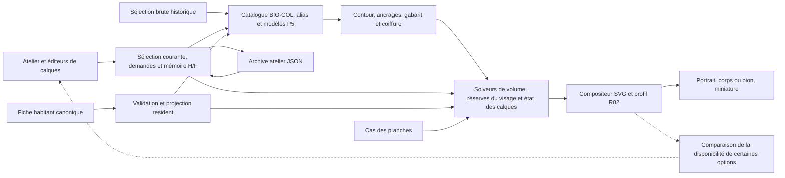

# Dépendances de l’éditeur adulte · BIO-EPURE-01-R01

Référence de code `6d5484d9350b05cf1de3eee1a4173853685008f9` · PR #78. Les identifiants cités renvoient à l’[inventaire](INVENTAIRE.md). Le mot **demande** désigne la valeur conservée. **Effectif** désigne la projection calculée dans le contexte courant. Une demande peut redevenir visible après changement de porteur, de mode ou de base.

## Carte des chemins de données

| Couche | Entrées, effets et preuves | Incidence d’une épuration |
| --- | --- | --- |
| Interface | `index.html` fixe la navigation et les zones. `app.mjs` crée les commandes et orchestre sélection, changement de base, domaines des yeux, rendu et archives. Les modules d’édition montent leurs états, leurs curseurs et leurs alertes. [HTML](../../../bio-yeux-01/index.html) · [Orchestration](../../../bio-yeux-01/app.mjs) | Un raccourci, une planche ou une commande se masque en conservant l’état et les chemins de restauration. |
| Catalogue | BIO-COL charge les entrées et redirections des dédoublonnages. P5-I6 normalise les formes, construit la tête et choisit géométrie et calques de la coupe. La surcharge de l’atelier ajoute les bases adultes et le groupe 48-D/65-D. [Catalogue](../../../bio-yeux-01/catalogue.mjs) · [Sélection BIO-COL](../../../bio-col-01/selection.mjs) · [Modèle P5](../../../preview/bio-vis-p5-i6/model.mjs) | Garder les clés ordinaires et historiques séparément de leur visibilité. Les variantes G et D restent identifiables. Une coupe U garde son identifiant propre. |
| Solveurs | Chaque famille valide son domaine puis calcule une géométrie compatible avec ses réserves. Une demande peut être corrigée par le solveur, masquée, ou suspendue sans être effacée. [Domaine des yeux](../../../bio-yeux-01/eye-domain.mjs) · [Morphologie adulte](../../../bio-yeux-01/adult-body.mjs) | Une modification du solveur ou des bornes peut aussi changer ce que l’archive historique attend dans ses valeurs effectives. |
| Compositeur | `render.mjs` part du SVG hérité et remplace le tronc adulte, les contours et les calques nécessaires. La substitution de formes historiques attend notamment les ouvertures, le nez, la bouche et les sourcils du dessin hérité. [Rendu](../../../bio-yeux-01/render.mjs) · [Rendu capillaire BIO-COL](../../../bio-col-01/render.mjs) | Déplacer un panneau conserve le rendu. Retirer la chaîne historique ou modifier son SVG peut rendre un calque introuvable. |
| Formats | `appearance.mjs` encode les demandes et leurs projections, `workshop-archive.mjs` enveloppe l’apparence, `resident.mjs` valide et projette un habitant autonome. Les opérations ont des entrées et validations propres. [Apparence](../../../bio-yeux-01/appearance.mjs) · [Atelier](../../../bio-yeux-01/workshop-archive.mjs) · [Habitant](../../../bio-yeux-01/resident.mjs) | Séparer les décisions d’ergonomie des migrations de formats. Le JSON d’habitant peut être réexporté avec la même identité sans commande de l’atelier. |
| Études | Les modules d’étude utilisent le compositeur avec des entrées de référence, parfois avec un profil, une teinte de peau ou un tracé ancien explicitement demandé. Les cartes capillaires et la Planche des formes proposent aussi des raccourcis d’application. [Études et commandes](../../../bio-yeux-01/app.mjs) | Archiver l’accès aux études conserve des références de validation. Les boutons d’application peuvent être retirés séparément si le sélecteur principal reste disponible. |

## Dépendances de projection par famille

| Inventaire | Porteur et dépendances amont | Effet en aval, latences et risque |
| --- | --- | --- |
| A1 · A2 | La base H/F et la ligne du menton déterminent la silhouette. L’ossature place les largeurs de référence. La corpulence déforme le contour interpolé. | La même enveloppe fournit les marges du thorax et du bassin, la surface abdominale et les reliefs osseux. Le pied du pion et la base pelvienne sont des repères distincts. [Corps adulte](../../../bio-yeux-01/adult-body.mjs) · [Corpulence](../../../bio-yeux-01/body-corpulence.mjs) |
| A3 · A4 | Poitrine F ou pectoraux H, sous contraintes de base, contour thoracique et corpulence. La poitrine peut modifier l’enveloppe et ses occultations. | Au volume zéro, les axes secondaires restent en mémoire. Les volumes servent de support aux positions et superpositions aréolaires. [Poitrine](../../../bio-yeux-01/chest.mjs) · [Pectoraux](../../../bio-yeux-01/pectorals.mjs) |
| A5 | Le support est plat, mammaire ou pectoral. Positions bornées par la zone disponible, pigment dérivé de la peau. | Les valeurs H/F diffèrent. Le bloc est facultatif. En son absence, il reste à appliquer la référence pour matérialiser le calque réglable. Les anciennes dimensions du mamelon sont relues en provenance. [Détails thoraciques](../../../bio-yeux-01/thorax-details.mjs) |
| A6 · A7 | L’enveloppe abdominale, le pli et les reliefs sont issus de la base et de la corpulence. L’abdomen prend aussi ses quatre demandes musculaires. | Le pli contraint l’espace pelvien. R02 calcule le pointillé à partir de la pousse, de la surface disponible et du pigment. Les valeurs à zéro ont un sens visuel. [Abdominaux](../../../bio-yeux-01/abdominals.mjs) · [Pli et nombril](../../../bio-yeux-01/belly-details.mjs) · [Pelvis](../../../bio-yeux-01/pelvic-details.mjs) · [Pointillé](../../../bio-yeux-01/pubic-stipple.mjs) |
| B1 · E1 | Huit coefficients du gabarit, géométrie P5 et arrangement de coupe. L’implantation dépend de la coupe et du recalage de la calotte. | Déplacent contour et ancrages utilisés par les solveurs faciaux. En l’absence d’effet, l’atelier conserve le dernier arrangement, les options ou l’implantation. [P5](../../../preview/bio-vis-p5-i6/model.mjs) · [Disponibilités](../../../bio-yeux-01/availability.mjs) |
| C1 | Le contour et les ancrages du visage définissent les réserves autour des yeux. Les formes personnalisées respectent notamment le contour, la médiane, le nez hérité et le rapport hauteur/largeur. | Définit l’ouverture que réutilisent pigment, plis, cils, sourcils, nez, maquillage et réserves cutanées. L’historique conserve sa propre géométrie. [Yeux](../../../bio-yeux-01/eyes.mjs) · [Valeurs admissibles](../../../bio-yeux-01/eye-domain.mjs) |
| C2 · C3 | L’iris s’inscrit dans la découpe de l’ouverture. Les détails se calent sur les arcs et les réserves visibles. | Le mode d’hétérochromie détermine si le pigment secondaire et son échelle sont utilisés. Les plis, cils, cernes et poches peuvent rendre leurs axes secondaires inactifs. Les détails des yeux fournissent des obstacles aux calques voisins. [Iris](../../../bio-yeux-01/iris.mjs) · [Détails](../../../bio-yeux-01/details.mjs) |
| C4 | Ouverture, contour, arcade et pigment de cheveux résolu. La nuance indépendante ou le lien assombri modifient le pigment. | Sans sourcils suspend les demandes de géométrie et de couleur. Modifier l’ordre des calques ou la couleur de cheveux peut changer ce que le lien chromatique donne. [Sourcils](../../../bio-yeux-01/brows.mjs) |
| D1 · D2 | Le nez respecte l’ouverture, les détails périoculaires et la bouche. La bouche utilise la réserve sous le nez. | La géométrie du nez et de la bouche est réutilisée par la barbe, les marques, les cicatrices et le maquillage. La validation doit couvrir nez et bouche actifs ensemble. [Nez](../../../bio-yeux-01/nose.mjs) · [Bouche](../../../bio-yeux-01/mouth.mjs) |
| E2 | Contour, yeux, détails, nez, bouche et pigment. En atelier la catégorie est un état graphique distinct de la base corporelle. | F suspend le calque en atelier et laisse ses demandes disponibles. `physical.beard` ne contient pas de catégorie. `voluntary.shaved` supprime la projection tout en gardant les demandes déclarées. [Barbe](../../../bio-yeux-01/beard.mjs) · [Contrôles](../../../bio-yeux-01/beard-editor.mjs) · [Projection canonique](../../../bio-yeux-01/resident.mjs) |
| F1 · F2 | Repère de peau `surface.mjs`, contour facial et obstacles des ouvertures, narines et lèvres. Les graines répartissent les groupes ou stabilisent la forme irrégulière. | Recalibrer un obstacle peut déplacer, contraindre ou empêcher une marque ancienne. Identifiants persistants dans les listes. Le canon reçoit l’origine d’une marque par la liste choisie par l’appelant. [Surface](../../../bio-yeux-01/surface.mjs) · [Marques](../../../bio-yeux-01/marks.mjs) · [Cicatrices](../../../bio-yeux-01/scars.mjs) |
| G1 · G.iris · G.maquillage | Palette capillaire, palette des iris et pigments de composition ont des jetons distincts. La peau héritée sert de pigment de calcul local. | Teinture prioritaire sur la nuance naturelle dans le canon. Barbe et sourcils peuvent hériter du pigment capillaire. Les teintes cutanées d’étude n’ajoutent aucun champ de peau. [Palette capillaire](../../../bio-col-01/palette.mjs) · [Rendu](../../../bio-yeux-01/render.mjs) |
| J1 · J2 | Lèvres sur géométrie buccale, ombre et liner sur ouvertures et contours, joues et peinture sur la surface disponible. Composition ordonnée, symétrie facultative. | Une famille peut être inactive avec demandes conservées. Le maquillage applique ses masques et la barbe est composée ensuite. Les noms et la bibliothèque locale restent propres à l’éditeur. [Rendu du maquillage](../../../bio-yeux-01/makeup-render.mjs) · [Atelier maquillage](../../../bio-yeux-01/makeup-editor.mjs) |

Le compositeur résout d’abord l’ouverture, les iris et les détails, calcule sourcils, nez et bouche, puis compose les marques, cicatrices, maquillage et barbe. L’ordre du **comparatif** « Avant / après » suit une autre priorité d’affichage. Il ne définit ni l’empilement des calques ni une préséance biologique. [Compositeur](../../../bio-yeux-01/render.mjs) · [Comparatif](../../../bio-yeux-01/app.mjs#L215)

## Frontières de sauvegarde

| Support | Champs propres et comportement | Conséquence d’une suppression |
| --- | --- | --- |
| Sélection historique brute | Style, arrangement, corps et options du catalogue, axes de morphologie et autres clés historiques préservées. Le stockage brut peut garder des clés même si le rendu courant les ignore ou force un gabarit. | Enlever l’option ordinaire garde l’import brut. Enlever la clé du catalogue ou la redirection casse un usage historique. [Sélection](../../../preview/bio-vis-dedup-lot-2/selection.mjs) |
| `microcosme.appearance` v1–v22 | Métadonnées du dessin, `character`, `historicalSelection`, `eyes`, `palette`, blocs selon la version et les réglages. Les modules pris en charge sauvegardent demandes et valeurs effectives, ou état historique et demandes latentes. L’import reconstruit les données et compare les projections attendues selon la version. | Une variation de valeur effective ou de normalisation peut faire échouer une ancienne restitution. Les habitudes d’édition, comme le volet ouvert ou le fond, n’appartiennent pas au contrat. [Formats](../../../bio-yeux-01/appearance.mjs) |
| `microcosme.workshop` v1 | Apparence `active`, `inactiveBodies`, `renderProfile` et, si nécessaire, `historicalSource`. Ouvrir une apparence sans enveloppe restaure seulement la base qu’elle contient et remplace la mémoire H/F précédente. | Garder les demandes des deux bases et les données originales validées même si la vue simplifiée les masque. [Archives atelier](../../../bio-yeux-01/workshop-archive.mjs) |
| `microcosme.adult-resident` v1 | Une identité fournie par l’appelant, une base adulte, demandes déclarées, états physiques, modifications acquises/volontaires, historique déclaré et provenance de génération possible. Doublons d’identifiants de marque interdits entre les deux listes. Aucun SVG stocké. | Toute suppression de clé canonique demande un contrat de compatibilité. Le format ne reprend ni mémoire de seconde base, ni état des panneaux, ni catégorie d’atelier de la barbe. [API habitant](../../../bio-yeux-01/resident.mjs) |
| `microcosme.makeup` v1 | Composition autonome réutilisable. Les compositions nommées utilisent le navigateur local. Une composition appliquée est aussi une donnée du calque de l’atelier ou de la fiche. | Préserver les couleurs, clés de forme et l’ordre des peintures pour réimporter la composition. [Composition](../../../bio-yeux-01/makeup.mjs) · [Échange et stockage local](../../../bio-yeux-01/makeup-editor.mjs) |

### Repères de versions des apparences

| Versions | Extension ou différence | À préserver |
| --- | --- | --- |
| 1 à 6 | 1 yeux et palette, 2 iris, 3 détails des yeux, 4 sourcils, 5 bouche, 6 nez. | Base historique, formes, demandes, effectifs, latences et provenance de tirage lorsque présents. |
| 7 à 10 | 7 pilosité faciale, 8 marques, 9 cicatrices, 10 maquillage. | Catégorie/nuances de pilosité et leur suspension, identifiants des calques, composition ou valeurs latentes. |
| 11 à 13 | 11 base adulte, 12 ossature, 13 corpulence. | Le tronc et ses réglages explicites, avec la précision stockée dans le JSON. L’atelier continue à prendre en charge les corps hérités. |
| 14 à 16 | Poitrine. Les anciens champs `divergence` et `position` passent dans `chestOrigin`. La version 15 garde le profil R01 et la 16 le profil actuel du module. | Garder les six demandes actuelles et les deux valeurs de provenance. |
| 17 à 21 | 17 pectoraux, 18 détails du thorax, 19 abdominaux, 20 nombril, 21 aréoles actuelles. | Les demandes de taille/relief de mamelon et le réglage de nombril retirés restent dans `historicalSource` quand présents dans un document historique validé. |
| 22 | Pousse pelvienne. Le profil `bio-corps-06-svg@1` du document seul peut désigner l’ancienne texture ou le pointillé. | Valeur exacte de pousse. Afficher le pointillé R02 en signalant l’ambiguïté de l’origine. L’enveloppe atelier actuelle indique explicitement son profil. |

Les blocs précédents sont disponibles selon les règles de présence du parseur et du document. Le numéro de l’enveloppe atelier, la version de l’apparence, le profil SVG et la version éventuelle d’un futur générateur ont des fonctions distinctes. [Déclarations et migrations](../../../bio-yeux-01/appearance.mjs#L26) · [Contrat BIO-SOCLE-02](../bio-socle-02-r01/CONTRAT-TECHNIQUE.md)

### Champs conservés hors commande directe

| ID d’arbitrage | Fait vérifié | Option proposée |
| --- | --- | --- |
| `H.archive.chestOrigin.divergence` et `H.archive.chestOrigin.position` | Les deux valeurs anciennes sont relues et conservées comme provenance de la poitrine. | Archiver les commandes disparues et conserver les clés en lecture et en réexport. |
| `H.archive.nippleSize` et `H.archive.relief` | Les documents de thorax anciens valident les deux demandes. Le calque actuel garde les cinq réglages aréolaires. | Archiver le modèle ancien avec la source validée. Garder le calcul actuel. |
| `H.archive.navel` | Le bloc de nombril v20 reste validé dans le document d’origine quand il existe. Le calque actuel est calculé. | Conserver la conversion et archiver le contrôle ancien. |
| `H.archive.historicalSelection` | Le JSON brut peut conserver des clés en dehors des commandes visibles, notamment `shoulders`, `belly`, `hips`, `age` selon la sélection. Leur rôle dépend du chemin de normalisation. | Conserver les valeurs brutes et distinguer leur conservation de leur effet courant. |
| `I.option.monochrome` | Option historique et canonique de la coiffure, reconnue par le modèle, sans commande dédiée dans R02. Peut inhiber les accessoires selon le rendu hérité. | Conserver en lecture. Masquer dans un premier mode simplifié garde le contrat. |
| `I.canon.shaved` | Booléen volontaire de rasage propre à la fiche habitant. Coupe rasée, l’état « Imberbe » de l’atelier et pousse pelvienne zéro sont trois autres cas. | Conserver la distinction des états. La supprimer perdrait la réversibilité d’une barbe déclarée. |
| `I.canon.identity` · `I.canon.history` · `I.canon.generation` | Identité persistante, historique de provenance déclaré et provenance de tirage facultative. Le format valide la structure sans attribuer d’identité ni calculer de chronologie. | Conserver comme contrat. Générer ou transformer ultérieurement exige des règles d’appel explicites. |

[Apparence et migrations](../../../bio-yeux-01/appearance.mjs) · [Options héritées et catalogue](../../../preview/bio-vis-p5-i6/model.mjs) · [Format habitant](../../../bio-yeux-01/resident.mjs)

## Rendu et représentations

| ID | Atelier | API habitant | Part du dessin |
| --- | --- | --- | --- |
| `I.vue.resident-portrait` | « Tête · 300 px » | `portrait` | Tête, coiffure et calques faciaux. |
| `I.vue.resident-pawn` | « Corps · 178 px » | `pawn` | Tête et tronc. Porte ossature, état thoracique, ventre, bassin, pied et calques corporels. |
| `I.vue.resident-thumbnail` | « Miniature · 70 × 70 px » | `thumbnail` | Tête et simplifications de petite échelle. |

Le profil habitant courant `bio-corps-06-r02-svg@1` active contours naturels, reliefs osseux, finitions abdominales et détails pelviens compatibles. L’atelier admet aussi `bio-corps-06-r02-svg@1/historical-eyes` quand ses contours naturels sont désactivés par le profil de page. Les planches demandent en plus des cadrages et variantes historiques propres à leurs cas. Une comparaison entre SVG peut fixer l’instance. Plusieurs SVG montés ensemble utilisent chacun leur identifiant de découpe. [Cadrages](../../../bio-yeux-01/render-profile.mjs) · [API habitant](../../../bio-yeux-01/resident.mjs) · [Instance et calques](../../../bio-yeux-01/render.mjs)

## Ordre d’analyse d’un arbitrage

1. Relever l’ID de l’élément et identifier sa demande, sa projection et ses modes latents.
2. Pour une action d’interface, vérifier l’accès alternatif ou l’import. Une étude archivée peut encore servir de référence de recette.
3. Pour une action sur le défaut, le domaine ou le solveur, examiner les consommateurs indiqués ci-dessus. Comparer la projection aux trois échelles et le réimport des anciennes données.
4. Pour un retrait de champ, de valeur de catalogue ou de profil, expliciter la version de lecture et la migration à arbitrer. Les valeurs inactives et les alias historiques restent concernés.
