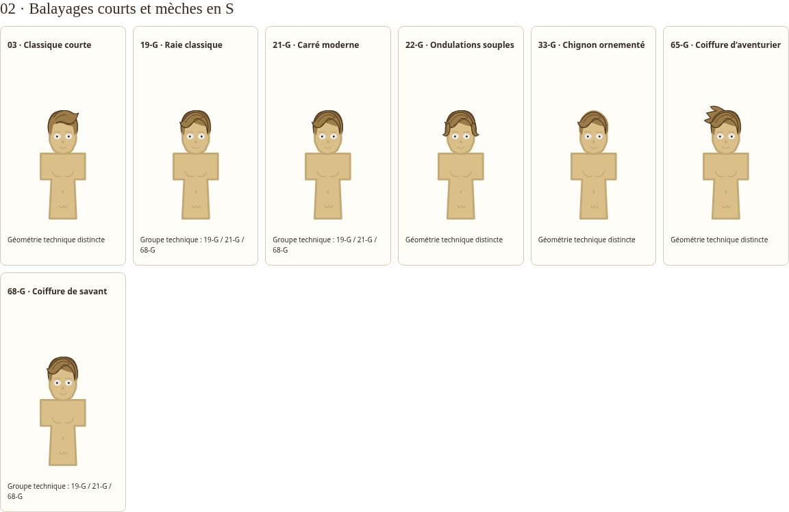

# BIO-VIS-AUDIT-01 — Pourquoi les coiffures se ressemblent

**Le prototype a 72 références et 126 choix, mais pas 72 constructions indépendantes.** L’audit retrouve des copies exactes, beaucoup de recettes partageant les mêmes éléments, et des écarts avec les grandes mèches des illustrations. Il ne modifie aucun générateur.

| Ce qui est compté | Résultat | Sens du chiffre |
| --- | ---: | --- |
| A · Références sélectionnables | **72** | 18 historiques + 54 références P5 à deux vignettes |
| Choix effectifs | **126** | 18 choix uniques + 108 G/D ; ce n’est pas 144 |
| B · Compositions géométriques non identiques | **111** | Égalité stricte des commandes de cheveux sur 270 états, objets et couleur exclus ; variantes numériques comptées séparément |
| C · Familles visuelles proposées | **32** | 31 familles de cheveux complets + le crâne explicitement rasé ; classement qualitatif explicite, pas une mesure universelle |
| Copies exactes | **10 groupes, 24 choix concernés** | **14 choix redondants** si l’on conserve un témoin par groupe ; aucune suppression effectuée |
| Quasi-doublons neutres | **5 paires, 4 rapprochements après copies exactes** | Recouvrement de silhouette ≥95 % au neutre ; ils ne sont pas identiques et restent différents sous déformation |

**111 ne veut pas dire 111 algorithmes ou 111 coiffures nettement différentes.** Un bord déplacé ou deux mèches ajoutées suffisent à produire une autre géométrie technique. Les 32 familles regroupent ces variantes selon les volumes visibles, les longueurs, les attaches et la texture. Elles ne rendent pas tous leurs membres interchangeables.

Parmi les 126 choix, **122 sont complets**, trois sont des **fragments observés** (66-G/D, 67-D) et un est entièrement inconnu sous tissu (**63-G**). « Complet » décrit ici une construction présentée comme complète par le programme, pas une reconstitution attestée des profils et dos du poster. Ce dernier choix inconnu est exclu du compte B ; il n’est jamais assimilé à une coupe rasée. Les trois fragments sont inclus dans B comme compositions partielles et placés hors des 32 familles complètes.

## Voir les preuves

- [Planche générale PNG](planches/planche-generale.png), [SVG vectoriel à zoomer](planches/planche-generale.svg), [version HTML autonome](planches/planche-generale.html).
- [Les dix groupes exacts et des voisinages à comparer](planches/doublons.png).
- [Quatre rapprochements au neutre et dans le cas iPad](planches/quasi-doublons.png).
- Originaux / programme : [V1](planches/source-V1.png), [A](planches/source-A.png), [B](planches/source-B.png), [C](planches/source-C.png), [D](planches/source-D.png), [E v1](planches/source-E.png), [F](planches/source-F.png).
- [Trois vues réellement livrées : cadrages et longueurs](planches/echelles.png).

Exemple : 19-G, 21-G et 68-G sont des copies exactes. Les autres membres de cette planche restent proches, mais ne sont pas identiques :

## Ce qui explique la ressemblance

Le système repose sur trois socles d’implantation. **118 choix utilisent l’enveloppe de recouvrement commune**, éventuellement masquée ; **102 choix ont le socle `classic`**. Ce socle commun est utile pour l’adaptation au visage, mais ne crée pas de diversité à lui seul. Au neutre, **24 arrangements contiennent exactement le bloc de mèche frontale de 19-G**, parfois avec d’autres volumes.

Les grandes mèches des posters sont souvent ramenées à cette mèche en S, à des pointes dentelées, ou à des rubans répétitifs. Les recettes ajoutent ensuite un chignon, une couronne, une ou deux nattes, un déport ou une longueur fixe. Les accessoires peuvent encore accentuer l’impression de nouveauté en couleur, alors que les cheveux sous-jacents restent identiques.

Autre constat : **sept coiffures historiques perdent leurs chemins de longueurs dans certaines vues agrandies ou miniatures**. Cela atténue la diversité visible dans ces vues, sans prouver que les géométries complètes sont identiques. Voir [PARAMETRES](PARAMETRES.md).

## Lire le dossier

1. [SYNTHESE](SYNTHESE.md) : conclusions et trois scénarios, sans décision imposée.
2. [INVENTAIRE](INVENTAIRE.md) : les 72 références, leurs 126 choix, modules, recettes, paramètres et niveaux de distinction.
3. [FAMILLES](FAMILLES.md) : les 111 classes techniques, le petit vocabulaire de dessin et les 32 familles visuelles.
4. [DOUBLONS](DOUBLONS.md) : copies prouvées, quasi-doublons, limites et contre-exemples.
5. [ECARTS_REFERENCES](ECARTS_REFERENCES.md) : lecture des 108 vignettes intégrées, différence conservée, réduite ou inconnue.
6. [PARAMETRES](PARAMETRES.md) et [ACCESSOIRES](ACCESSOIRES.md) : capacités réellement réglables et séparation des objets.
7. [METHODE](METHODE.md) : définition des comptes, provenance, scripts et vérifications reproductibles.

Base effective auditée : **P5-I6 publié au commit `4fb938a`**, comparé à la source de la PR #39 `6d476dc`. Documentation #33 `0d8cc1d`. [Preview existante](https://thsethse.github.io/Microcosme/preview/bio-vis-p5-i6/). Les 73–81 sont hors inventaire du code.

Les observations visuelles et les familles sont des propositions de lecture à vérifier avec les planches. Les égalités de commandes, comptes et capacités d’entrée sont des constats techniques. **Aucune modification du générateur, du jeu, des sauvegardes, des accessoires ou des couleurs ; aucune nouvelle preview publiée ; aucune fusion.**
