# Galerie de décisions — consultation directe sur iPad

Les PNG ci-dessous contiennent les originaux, les rendus **actuels** sans accessoires et la proposition argumentée. Toucher une image pour l’ouvrir et l’agrandir. Aucun « après » fictif, aucune correction appliquée. Toutes les décisions restent **En attente**.

[Retour à la synthèse](README.md) · [Tableau des décisions](DECISIONS.md) · [Revue des 32 familles](VARIANTES.md) · [HTML autonome à télécharger](GALERIE.html)

## E01 · Boucles courtes et couronne ondulée

Choix : **08 / 58-G** · Proposition : **DIFFÉRENCIER** · Décision utilisateur : **En attente**.

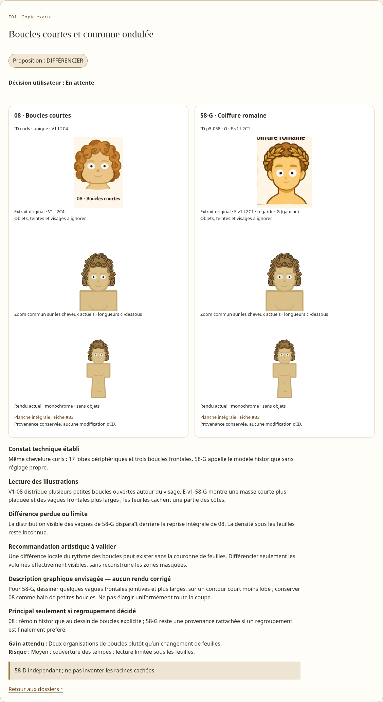

## E02 · Deux queues hautes, deux fronts

Choix : **12 / 24-D** · Proposition : **DIFFÉRENCIER** · Décision utilisateur : **En attente**.

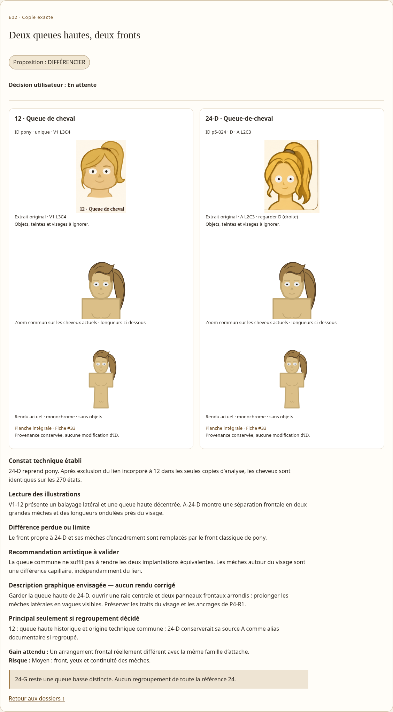

## E03 · Deux balayages équivalents et une grande mèche perdue

Choix : **19-G / 21-G / 68-G** · Proposition : **DIFFÉRENCIER** · Décision utilisateur : **En attente**.

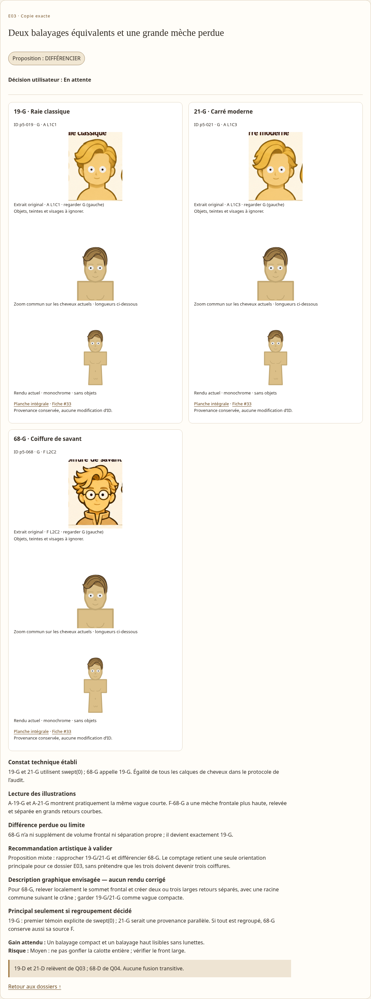

## E04 · La même couronne tressée

Choix : **28-G / 59-G** · Proposition : **REGROUPER** · Décision utilisateur : **En attente**.

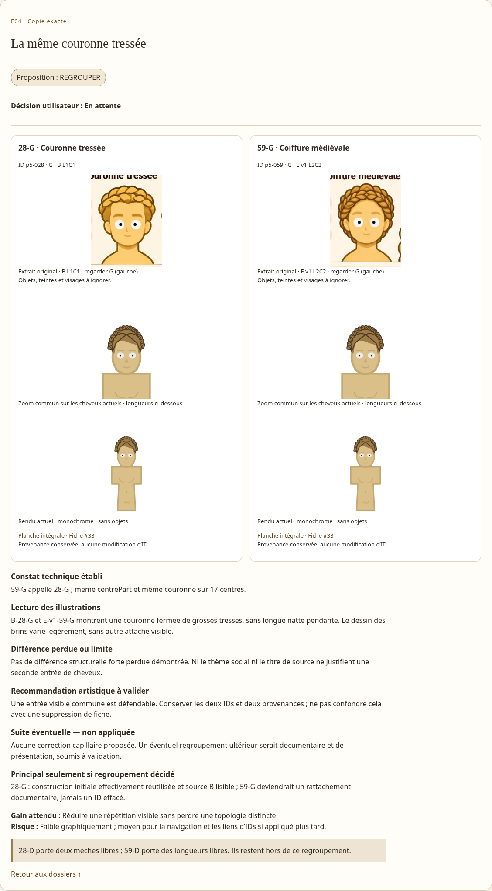

## E05 · Rouleaux de cour et rouleau frontal

Choix : **31-D / 58-D** · Proposition : **DIFFÉRENCIER** · Décision utilisateur : **En attente**.

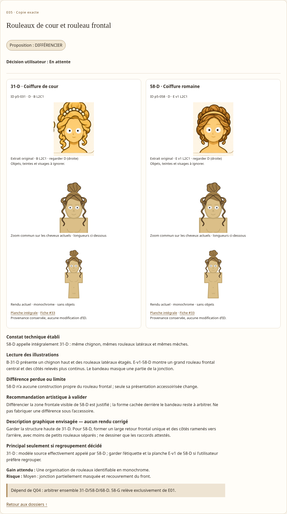

## E06 · Les pointes ne remplacent pas tous les balayages

Choix : **38-G / 48-G / 54-G / 69-G** · Proposition : **DIFFÉRENCIER** · Décision utilisateur : **En attente**.

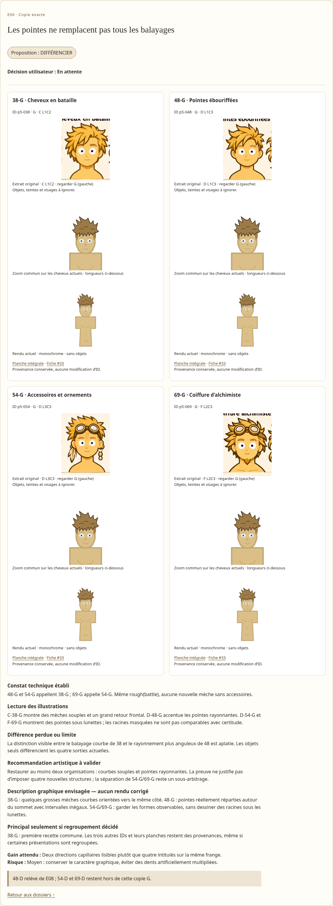

## E07 · La couleur ne crée pas une seconde coupe

Choix : **47-G / 50-G** · Proposition : **REGROUPER** · Décision utilisateur : **En attente**.

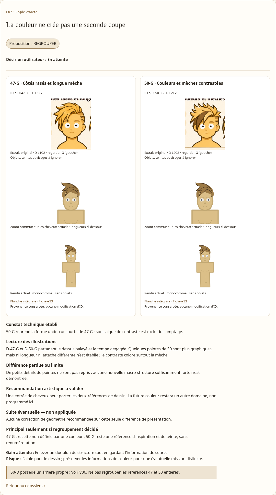

## E08 · Pointes longues et source partiellement occultée

Choix : **48-D / 65-D** · Proposition : **À ARBITRER** · Décision utilisateur : **En attente**.

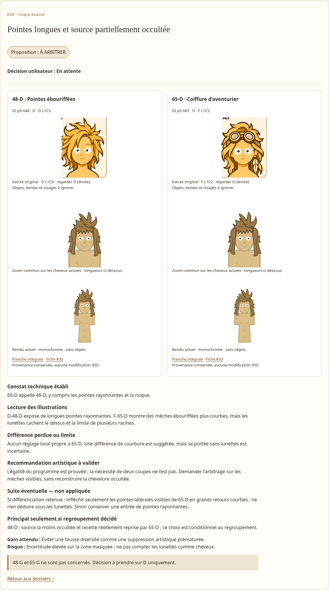

## E09 · Pointe oblique et grande nappe frontale

Choix : **49-G / 62-D / 71-G** · Proposition : **DIFFÉRENCIER** · Décision utilisateur : **En attente**.

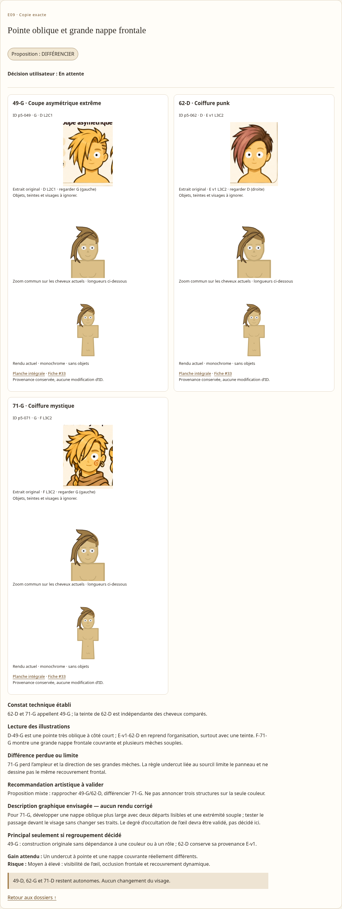

## E10 · Chignon central sur côtés courts

Choix : **64-G / 70-G** · Proposition : **REGROUPER** · Décision utilisateur : **En attente**.

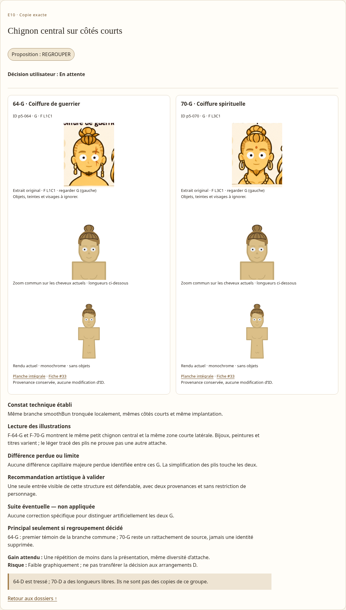

## Q01 · Deux nattes, avec ou sans mèches libres

Choix : **32-D / 60-D** · Proposition : **CONSERVER** · Décision utilisateur : **En attente**.

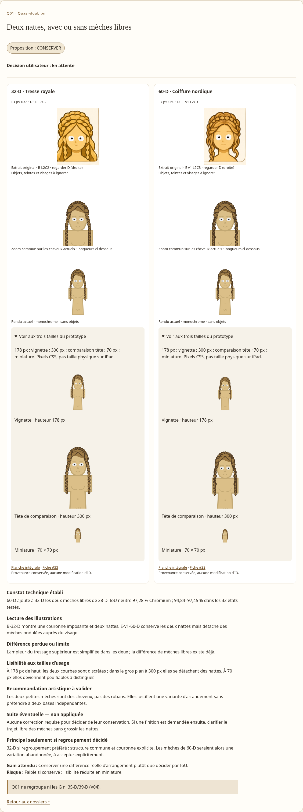

## Q02 · Tempe courte ou tempe tressée

Choix : **25-D / 44-D** · Proposition : **CONSERVER** · Décision utilisateur : **En attente**.

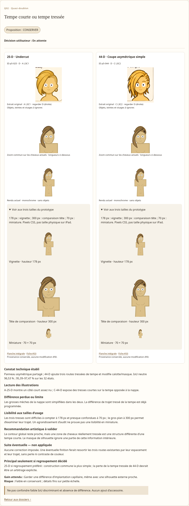

## Q03 · Carré arrondi et carré plus net

Choix : **19-D / 21-D** · Proposition : **DIFFÉRENCIER** · Décision utilisateur : **En attente**.

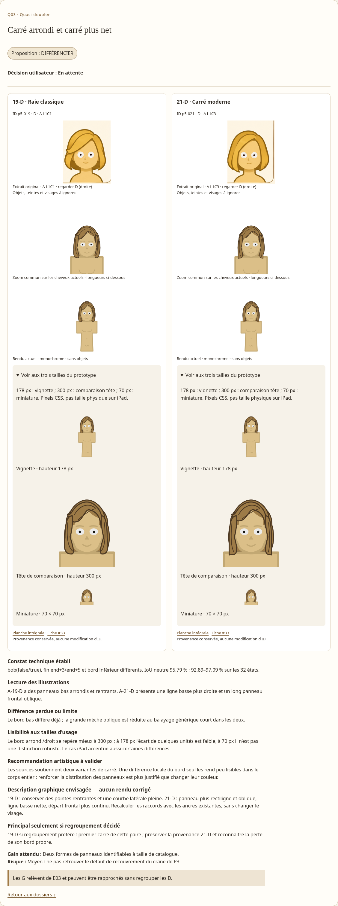

## Q04 · Un chignon différent ne suffit pas à reproduire trois fronts

Choix : **31-D / 58-D / 68-D** · Proposition : **DIFFÉRENCIER** · Décision utilisateur : **En attente**.

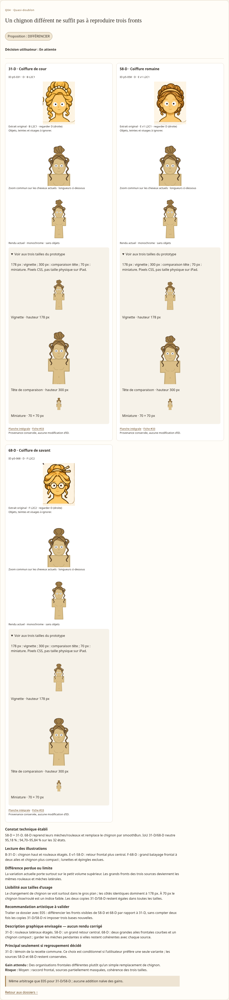

## V01 · Petit chignon et deux mèches fines

Choix : **56-G / 61-G** · Proposition : **REGROUPER** · Décision utilisateur : **En attente**.

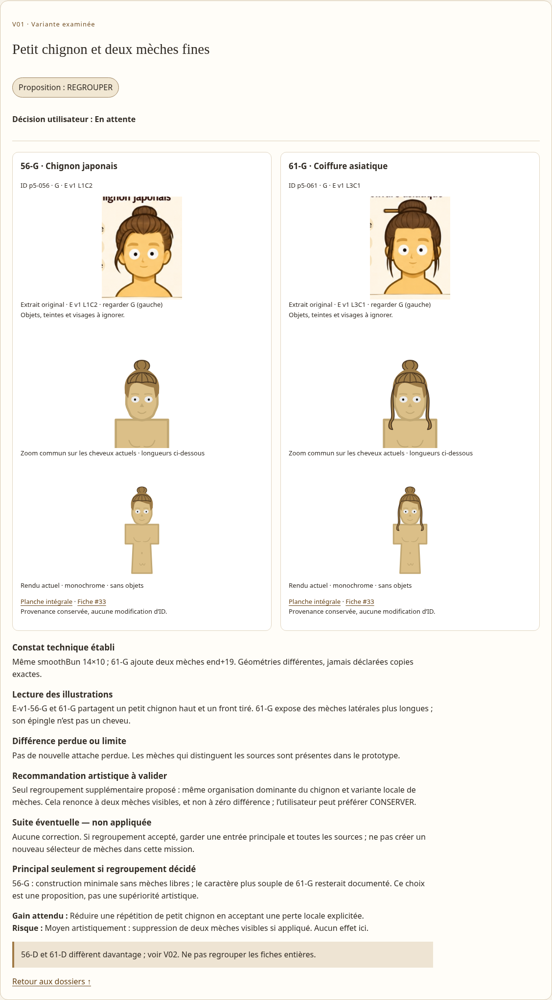

## V02 · Raie lisse et grand retour frontal

Choix : **56-D / 61-D** · Proposition : **DIFFÉRENCIER** · Décision utilisateur : **En attente**.

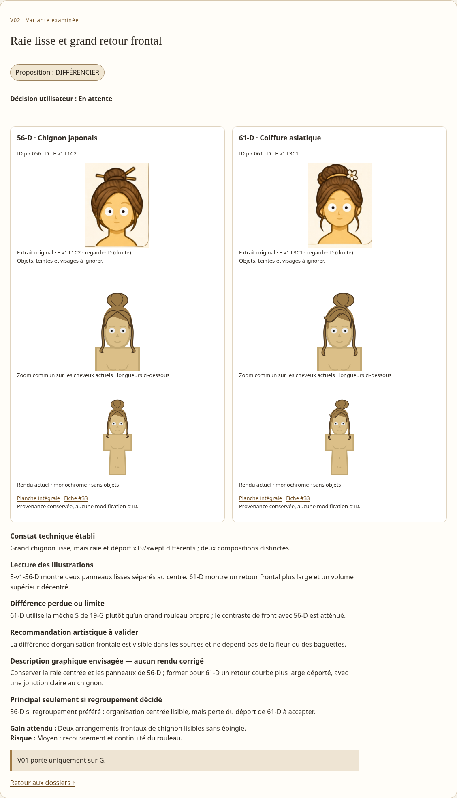

## V03 · Natte large et natte fine

Choix : **32-G / 35-G** · Proposition : **CONSERVER** · Décision utilisateur : **En attente**.

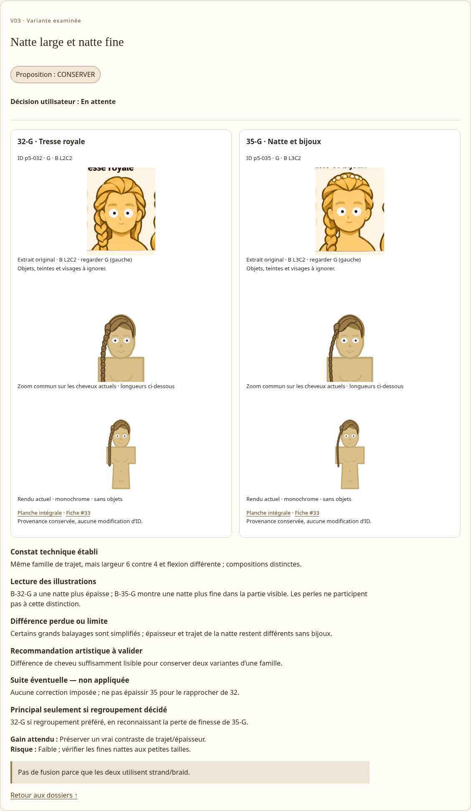

## V04 · Deux nattes et trois organisations du sommet

Choix : **32-D / 35-D / 39-D** · Proposition : **CONSERVER** · Décision utilisateur : **En attente**.

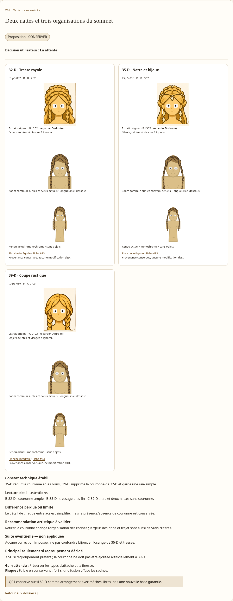

## V05 · Trois implantations de crête

Choix : **46-G / 46-D / 62-G** · Proposition : **CONSERVER** · Décision utilisateur : **En attente**.

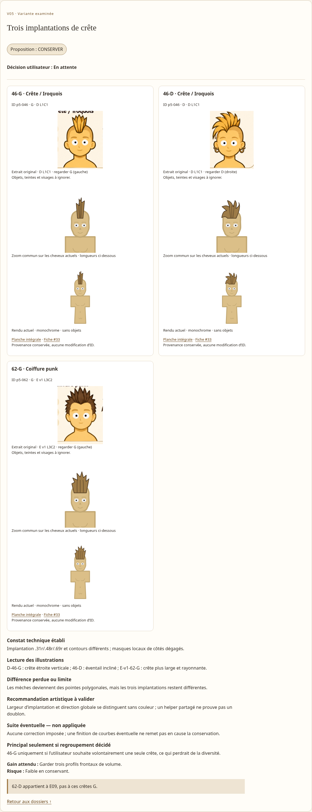

## V06 · L’arrière change réellement

Choix : **49-D / 50-D** · Proposition : **CONSERVER** · Décision utilisateur : **En attente**.

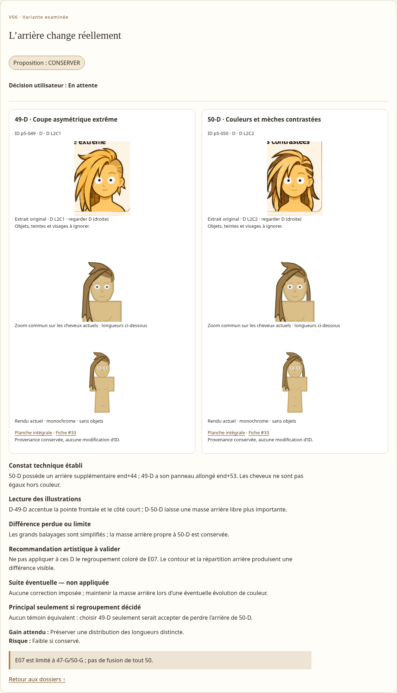

## V07 · Tresses fines trop régularisées

Choix : **53-G / 55-G / 55-D** · Proposition : **DIFFÉRENCIER** · Décision utilisateur : **En attente**.

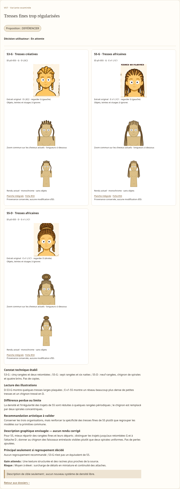

## V08 · Des fragments ne prouvent pas une coupe complète

Choix : **66-D / 67-D** · Proposition : **À ARBITRER** · Décision utilisateur : **En attente**.

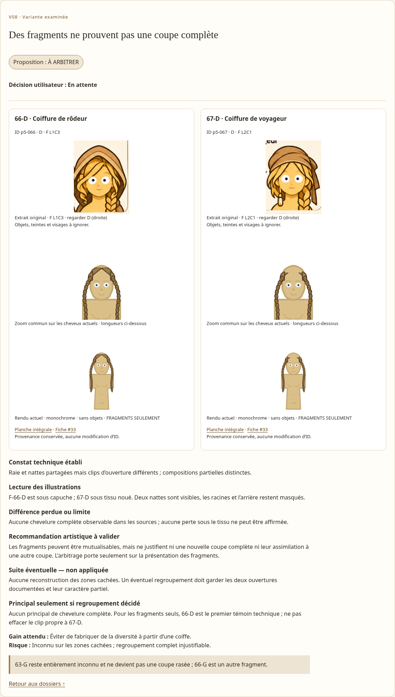

## V09 · Éventails et grands rouleaux

Choix : **29-G / 34-G / 51-G** · Proposition : **DIFFÉRENCIER** · Décision utilisateur : **En attente**.

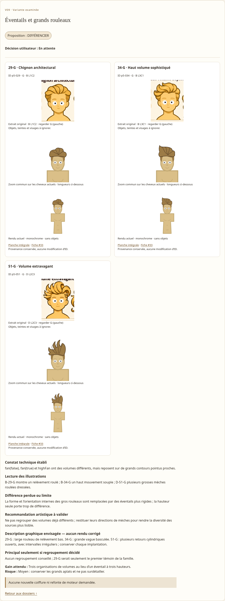

## V10 · Attaches irrégulières et volumes hauts

Choix : **23-D / 54-D / 69-D** · Proposition : **CONSERVER** · Décision utilisateur : **En attente**.

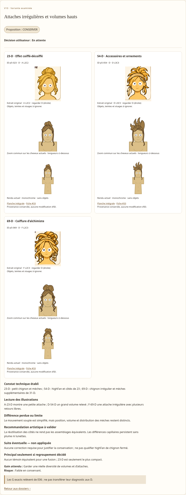

## V11 · Boucles et rouleaux ne se réduisent pas à un ruban

Choix : **27-D / 30-G / 30-D** · Proposition : **DIFFÉRENCIER** · Décision utilisateur : **En attente**.

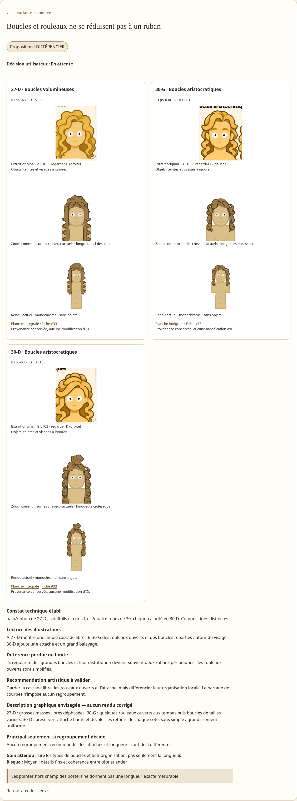

## V12 · Une natte et un second brin ambigu

Choix : **32-G / 41-D** · Proposition : **À ARBITRER** · Décision utilisateur : **En attente**.

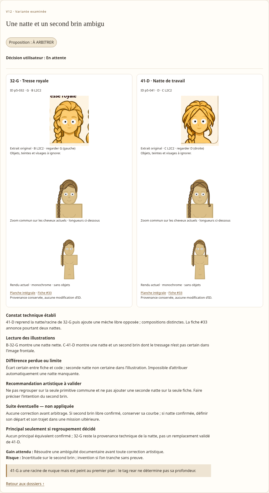

## Revue exhaustive des 126 choix

32 familles complètes proposées (122 choix), puis les fragments et l’inconnu, sans reconstitution sous tissu. [Ouvrir la planche entière](planches/familles.png).

