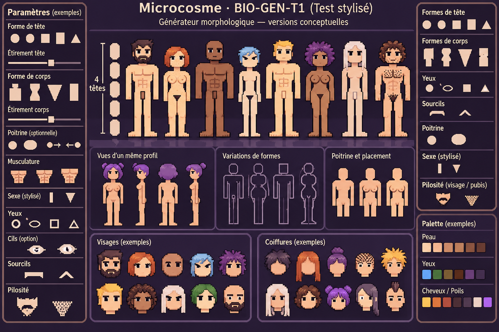

# BIO-GEN-T2 — référence artistique validée

## Statut et provenance

L'image fournie par l'utilisateur dans la conversation, titrée **« Microcosme · BIO-GEN-T1 (Test stylisé) — Générateur morphologique — versions conceptuelles »**, constitue la **direction artistique explicitement validée pour le laboratoire morphologique géométrique BIO-GEN-T2**.

La dénomination BIO-GEN-T1 inscrite sur cette planche est conservée : son usage comme référence artistique de T2 est explicitement demandé et validé par l'utilisateur le 15 novembre 2026.

## Rôle de la référence

La planche guide :

- les proportions générales de quatre hauteurs de tête, avec étirements locaux autorisés ;
- la construction en formes géométriques élémentaires et la lisibilité des silhouettes ;
- les visages simplifiés, yeux et sourcils géométriques, sans nez ;
- les coiffures stylisées adaptées aux formes de tête ;
- la musculature principalement carrée ou rectangulaire et la poitrine ronde ou ovale ;
- la colorimétrie et les palettes cohérentes de pixel art ;
- les représentations anatomiques schématiques non explicites et la pilosité faciale/pubienne indépendante.

La référence définit une direction graphique et un niveau de stylisation ; elle n'impose pas de reproduire chaque personnage à l'identique et ne valide aucun modèle biologique canonique. Les caractères corporels ne déterminent ni identité de genre, ni orientation, ni fertilité ou comportement. La spécification T2 conserve une option anatomique neutre.

## Fichier et contrôle d'intégrité

Référence : [REFERENCE_ARTISTIQUE_T2.png](REFERENCE_ARTISTIQUE_T2.png).

- Format : PNG, **1536 × 1024 pixels**, **1 773 205 octets**.
- Provenance : fichier déposé par l'utilisateur dans le commit `30b528baa8452407e3ae2f1b6553ca9c3fe69b9a`, branche `docs/bio-gen-t2-reference`, sous le nom `a_detailed_infographic_in_pixel_art_retro_16_bit.png`.
- Nom normalisé : `docs/bio-gen-t2/REFERENCE_ARTISTIQUE_T2.png`.
- SHA-256 : `1a5b2d226f205066027e25bf930a9db6ea959ca5bfcba42f00fc5470d5c63a84`.
- Blob Git d'origine et du fichier renommé : `ab2f46b51feeb73a8339076bdb95ab9d76b6592d`.

**Identité binaire vérifiée** avec le PNG déposé par l'utilisateur sur GitHub : mêmes octets, même taille, même SHA-256 et même blob Git. Renommage seulement ; aucun redimensionnement, recadrage, conversion ou recompression. Ce contrôle porte sur le fichier PNG effectivement déposé par l'utilisateur, désormais accessible, et non sur une reconstitution de l'aperçu de conversation.

La référence est disponible pour la future mission de programmation T2. Sa présence n'autorise pas à lancer cette programmation dans la présente mission documentaire.

## Périmètre de cette mission documentaire

Cette mission dépose uniquement le PNG et cette notice sur la branche documentaire dédiée. Aucune programmation T2 supplémentaire, aucune modification du jeu, des sauvegardes, des comportements ou des prototypes B1/B2. Aucune fusion de PR.
