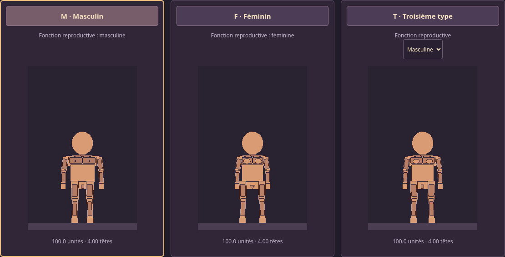
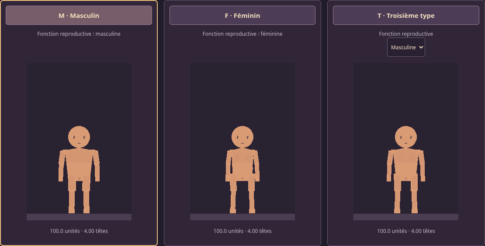
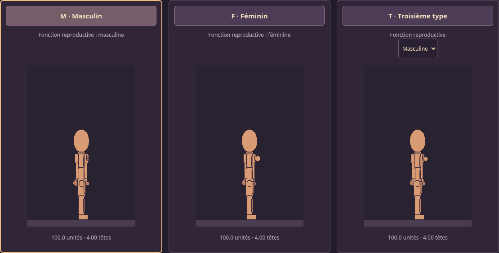
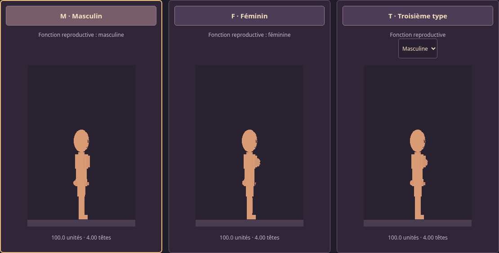
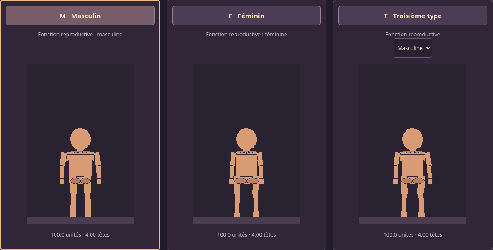

# Comparaison avant / après R1 — captures de vérification

Captures générées dans Chromium 151 Linux, viewport 1180×1100, DPR1, graine `t3-a-reference`, profils P2 réinitialisés, superpositions désactivées. Chaque image contient M/F/T à la même échelle. Ce sont des **résultats de rendu à auditer**, jamais une référence artistique validée substituée au croquis utilisateur.

Avant : T3-A `dfa56ba34c94de6bc80f3b2e4c58e584a2827c79`. Après : source R1 de cette branche, derniers changements documentaires exclus des fichiers applicatifs. Le commit applicatif publié figure dans PUBLICATION.md.

| Vue | T3-A avant R1 | T3-A-R1 |
|---|---|---|
| Face |  |  |
| Profil |  |  |
| Dos |  |  |

Reproduction : `node tests/bio-struct-t3-a/capture-r1.cjs AVANT_URL APRES_URL DOSSIER_SORTIE`. Les sources locales ont été utilisées pour ces captures ; les deux previews publiques restent accessibles pour la comparaison interactive. Pas de retouche des images.
