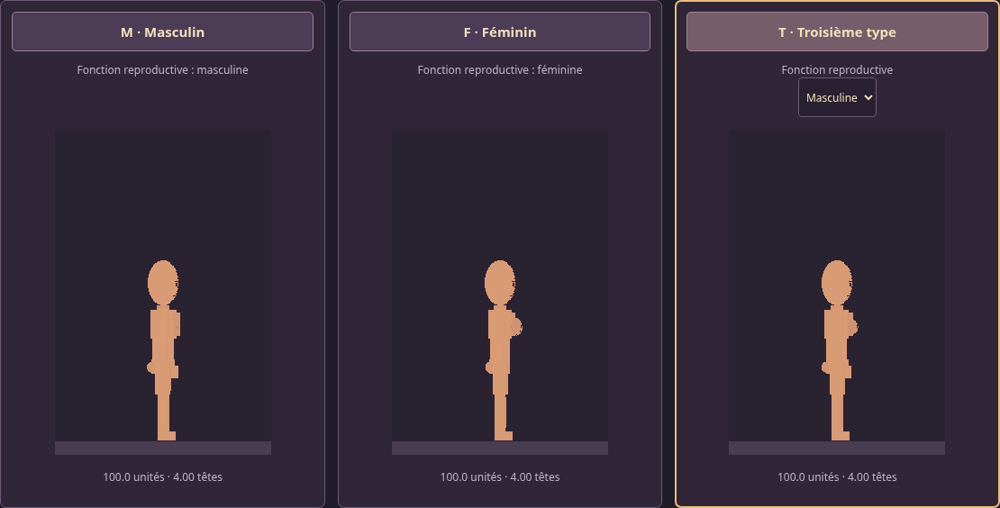
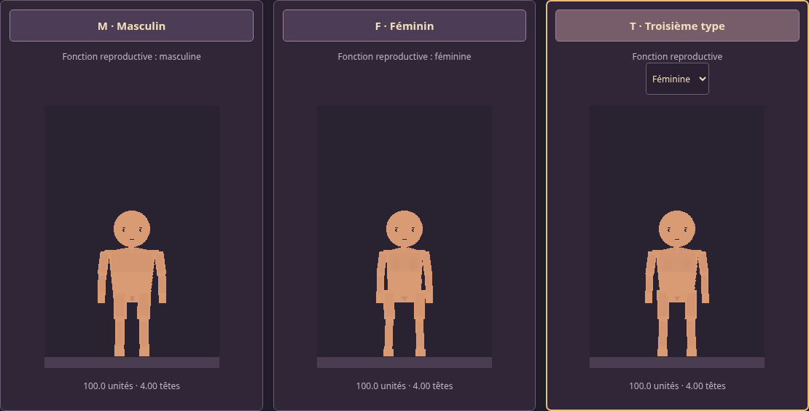
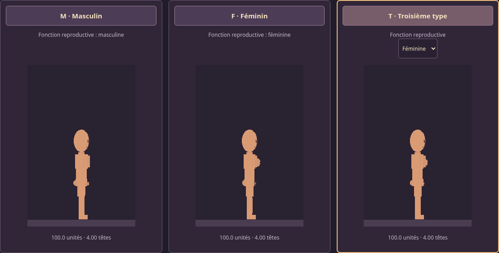

# Comparaison R1 / R2 — captures sans retouche

Chaque capture contient M/F/T à la même échelle, graine `t3-a-reference`, paramètres P2 réinitialisés, superpositions désactivées. R1 : `b05a3fe9b9ab0664fe1caf278bce9f5b10679520`. R2 : source applicative de cette branche, identifiée dans PUBLICATION.md. Chromium 151 Linux, viewport 1180×1100, DPR1. Ces rendus sont des preuves à examiner, jamais une nouvelle référence artistique validée.

## Troisième type à fonction masculine

| Vue | R1 avant | R2 après |
|---|---|---|
| Face |  |  |
| Profil |  |  |
| Dos |  |  |

## Troisième type à fonction féminine

| Vue | R1 avant | R2 après |
|---|---|---|
| Face |  |  |
| Profil |  |  |
| Dos |  |  |

Reproduction : `node tests/bio-struct-t3-a/capture-r2.cjs R1_URL R2_URL DOSSIER_SORTIE`. Les URL file:// des deux sources locales ont servi à ces captures. Le profil est le profil droit canonique ; les attributs antérieurs ne doivent pas apparaître de dos. Comparer le couple T : sa poitrine reste identique lorsque la fonction change.
