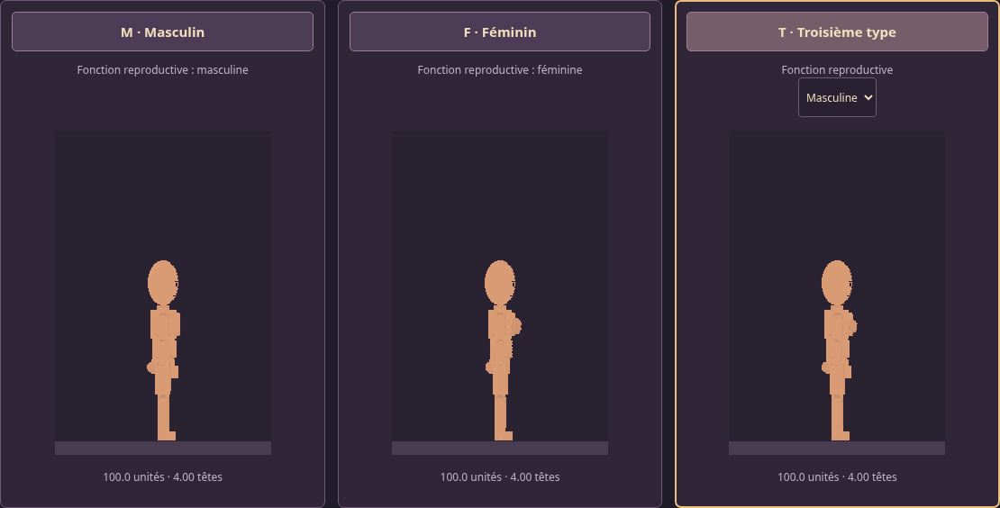
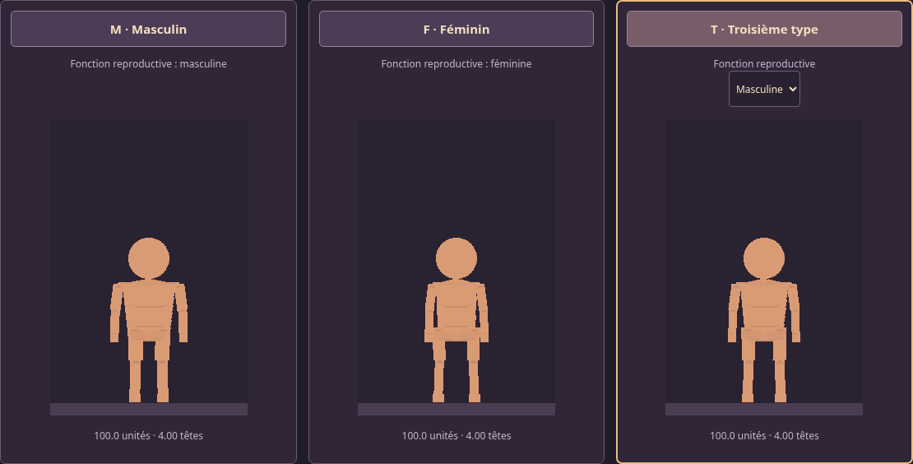
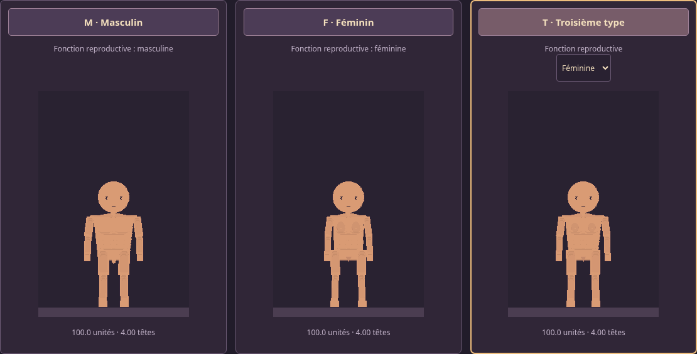
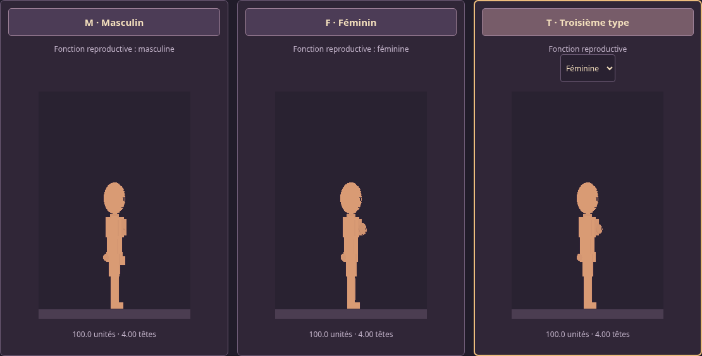
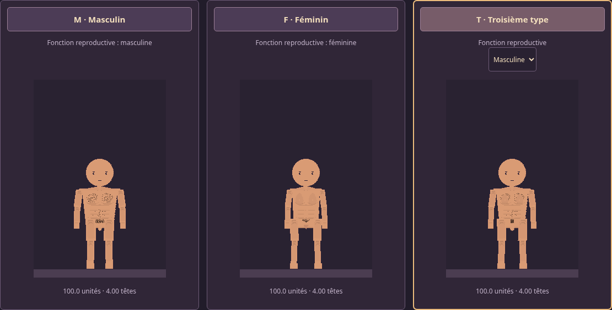
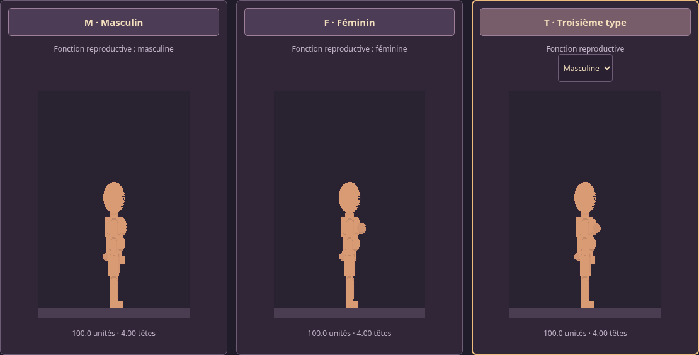
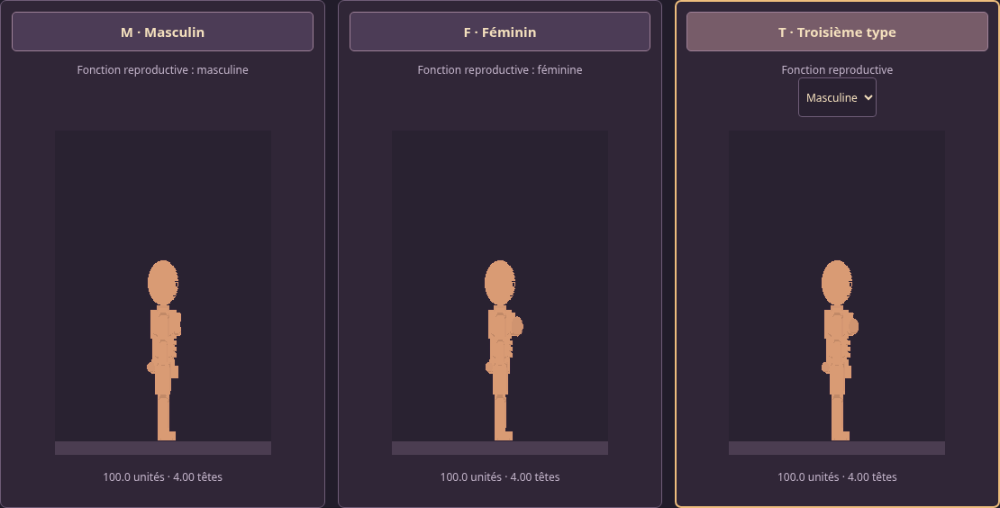

# Comparaisons R2 / R3 — captures sans retouche

Avant : R2 `bf9f6d002bed891344dd2f954a33c4126baa84e1` (code applicatif `0f08780`). Après : source finale R3 `be0779be4809ea321ab4485bf66ff9c7900b1e65`, identifiée dans PUBLICATION.md. Graine `t3-a-reference`, trois références P2 réinitialisées, superpositions désactivées. Chromium 151 Linux, viewport 1180×1100, DPR1. Les captures sont des résultats à examiner, jamais une référence artistique approuvée substituée au croquis utilisateur.

## T à fonction masculine

| Vue | R2 | R3, défauts proches de R2 |
|---|---|---|
| Face |  |  |
| Profil |  |  |
| Dos |  |  |

## T à fonction féminine

| Vue | R2 | R3, défauts proches de R2 |
|---|---|---|
| Face |  |  |
| Profil |  |  |
| Dos |  |  |

## Exemples des réglages R3

La définition passe de 0 à 1 ; graisse 0.85 → 0.10, ombres 0.70. F/T : poitrine arrondie → goutte, taille F 0.75/T 0.60 ; les choix restent indépendants dans le prototype. Torse/ventre : densité M/T 0.65/0.50, F sans poils corporels ; pubis M rectangle, F triangle, T carré, densité 0.70. Ce sont des exemples explicites, pas de nouveaux profils biologiques.

| Vue | Souple et rond | Défini |
|---|---|---|
| Face |  |  |
| Profil |  |  |
| Dos |  |  |

Reproduction : `node tests/bio-struct-t3-a/capture-r3.cjs R2_URL R3_URL DOSSIER_SORTIE`. Les sources locales file:// ont servi à ces captures. Le script utilise les mêmes contrôles que l’utilisateur, sans retouche d’image. Zoomer pour juger les points et ombres de pixel art ; l’affichage réel Safari iPad reste à tester.
