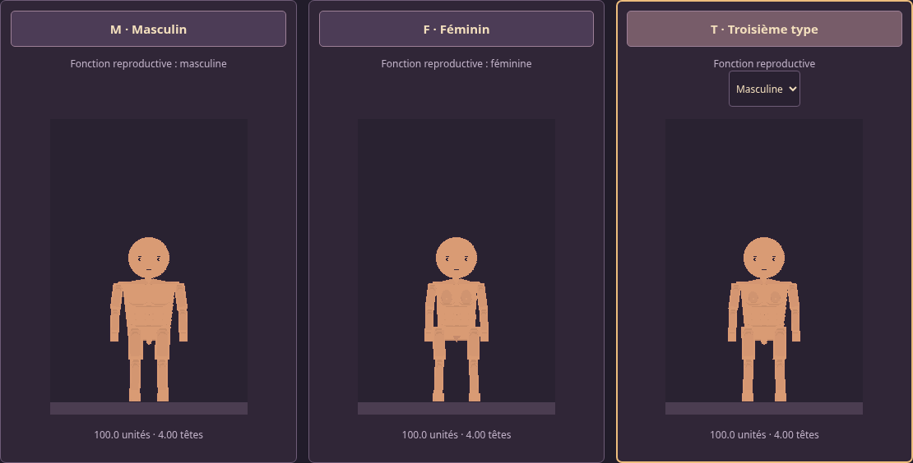
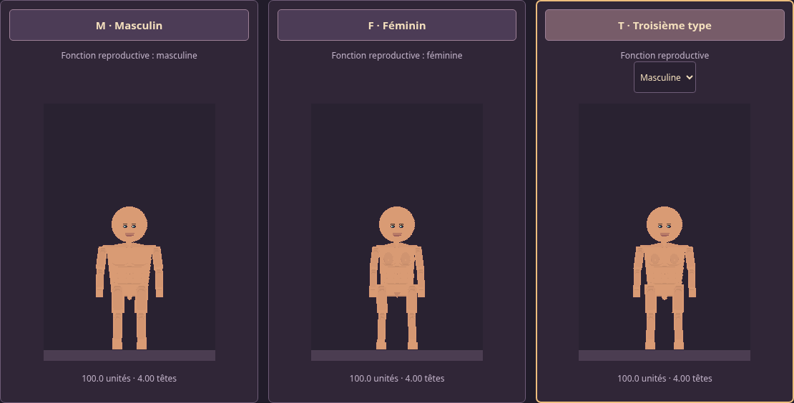
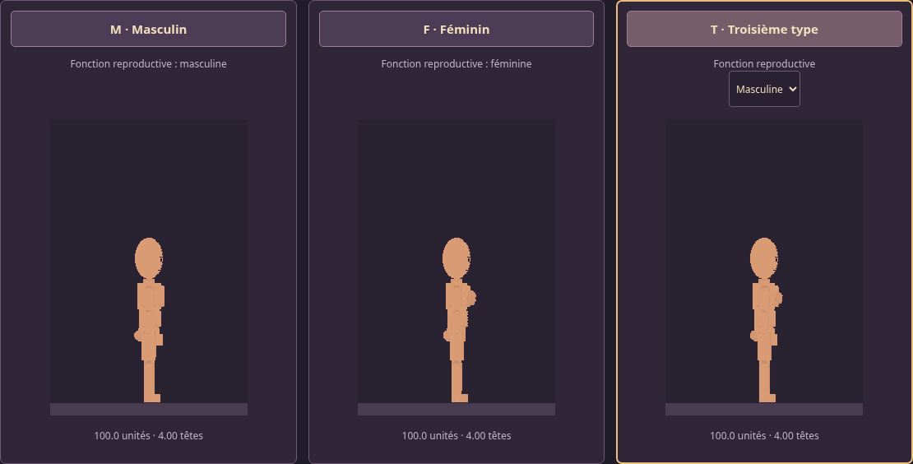
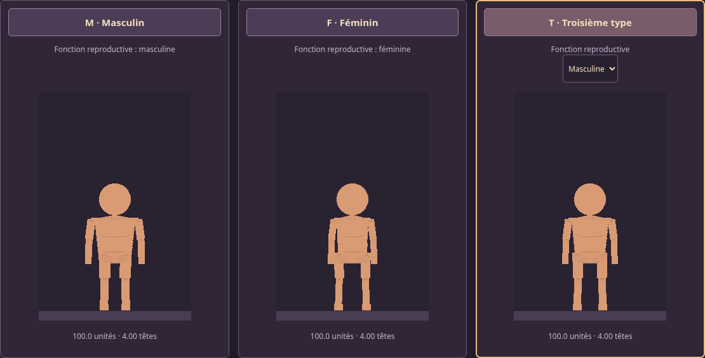
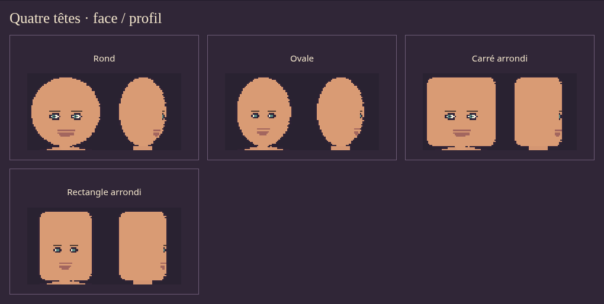
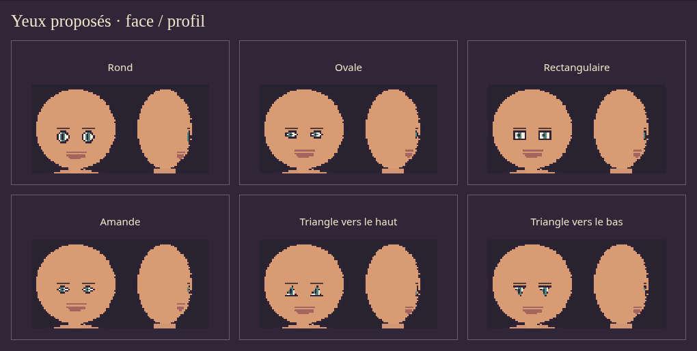
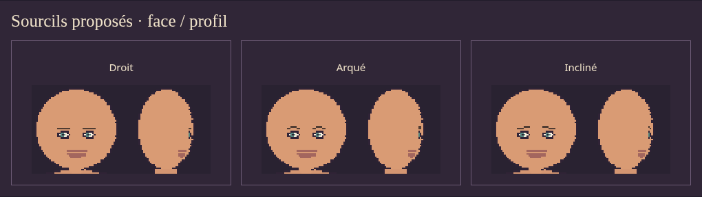
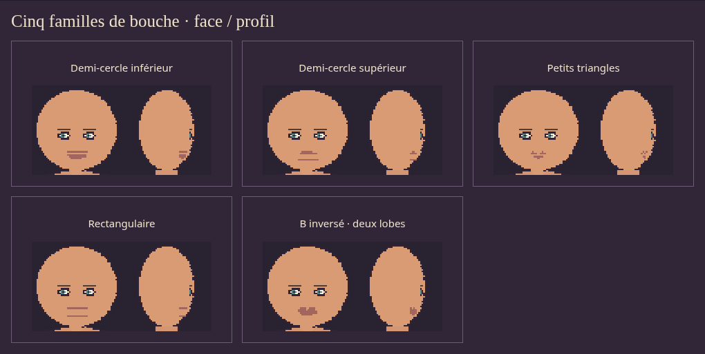
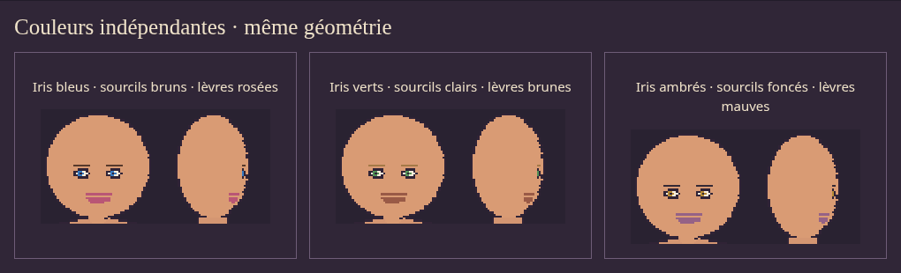
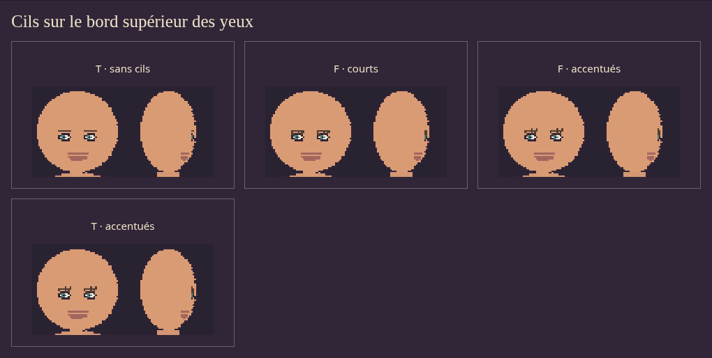

# Comparaisons et catalogues B1 — captures sans retouche

Avant : R3 `0749e4d4d54ea55a14cf63dda82b32e544e020e8`, application `be0779b`. Après : source B1 indiquée dans PUBLICATION.md. Les captures proviennent de Chromium 151 Linux, viewport 1180×1100, DPR1, graine `t3-a-reference`, défauts corporels P2/R3. Les planches sont des résultats proposés, pas une nouvelle référence artistique validée.

## Références M/F/T — T à fonction masculine

| Vue | R3 | B1 |
|---|---|---|
| Face |  |  |
| Profil |  |  |
| Dos |  |  |

## Références M/F/T — T à fonction féminine

| Vue | R3 | B1 |
|---|---|---|
| Face |  |  |
| Profil |  |  |
| Dos |  |  |

## Quatre têtes

## Six formes d’yeux

## Trois sourcils

## Cinq familles de bouche

## Trois jeux de couleurs indépendantes

## Cils F et T

Les portraits sont pris depuis les vrais canvas de l’interface, eux-mêmes agrandissements du rendu canonique. Taille d’yeux 1.35 dans les planches, tête ronde sauf catalogue de têtes ; mêmes réglages pour isoler les formes, puis couleurs variées dans la planche dédiée. Aucune retouche.

Reproduction : `node tests/bio-struct-t3-b1/capture.cjs R3_URL B1_URL DOSSIER_SORTIE`. Sources locales file:// utilisées. Le profil montre un seul œil ; la finesse des traits dépend de la profondeur et de la résolution, à juger sur iPad. Les corps et le dos sont conservés hors contour de tête approuvé.
