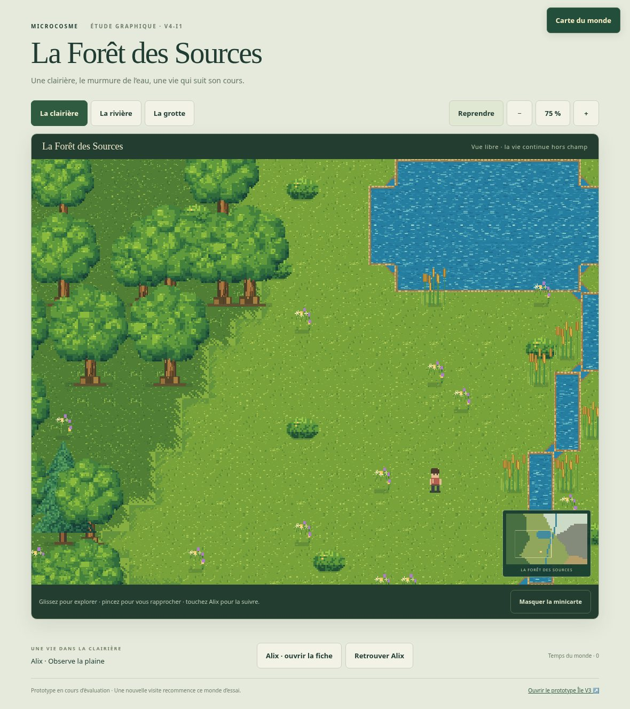
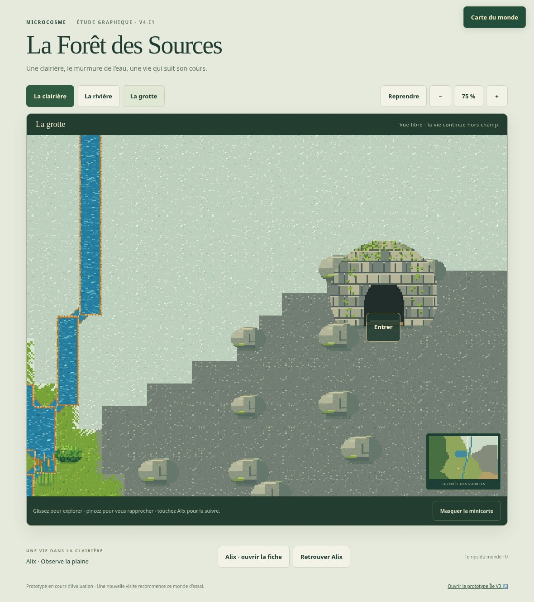

# V4-I1 — La Forêt des Sources

Prototype pour audit et essai utilisateur. **Ne pas fusionner ni généraliser V4.**

Page source : `forest.html`. Prévisualisation indépendante prévue :
<https://thsethse.github.io/Microcosme/preview/v4-i1/forest.html?v=v4-i1-1>.
Le statut effectif de publication et les contrôles HTTPS sont consignés dans `PUBLICATION.md`.

## A — Audit et références

La demande utilisateur autorise les lots B–D à partir de la PR #10, commit
`ce3e46f4d7f10bfc2968c1d5ce96bf10ce22098c`. La branche dédiée
`codex/v4-i1-foret-des-sources` en descend directement ; sa PR cible
`codex/island-v3` pour isoler les ajouts V4. Aucune fusion des PR #5/#7/#8/#9/#10/#11.
`main` observée avant publication : `31b7e147a0ec937463f3de859b0e5f6ffb93005c`.
Aucun AGENTS.md dans les arbres/historiques examinés. Les documents de continuité
de la PR #5 distinguent les concepts C5 de leur implémentation ; cette mission
ne clôt aucun chantier de simulation.

Le [contrat V4-T1 transmis](V4-T1.md) est archivé tel que fourni.
L'original artistique `V4-S2_Foret_des_Sources_reference.png` a été examiné depuis
l'archive de transmission. SHA-256 :
`1d8b0f18afffdbb6739180875f30783372d9376902832cb8639793b608b5df23`.
Il n'est ni découpé, ni chargé par la page, ni incorporé aux sprites.
Les instructions de réalisation viennent de la demande utilisateur ; ces deux
documents servent de contrat technique et de référence visuelle dans ce périmètre.

## B — Décor assemblé et architecture

La scène est une fenêtre de présentation de 48 × 30 cases à partir de (24,12),
dans le monde V3 de 96 × 72 cases. Les coordonnées restent des cases de 32 × 32 px.
Cette fenêtre couvre la forêt existante, la clairière, l'eau et la grotte sans
déplacer Alix ni les lieux. Les raccourcis Clairière/Rivière/Grotte déplacent
uniquement la caméra. La carte globale reste un aperçu simplifié ; le rendu
détaillé V4 n'est pas appliqué à toute l'île.

| Couche | Fichier et rôle |
|---|---|
| Monde | `island-world.js`, strictement inchangé : terrain, lieux, positions, décisions, pas de 600 ms |
| Adaptation | `forest-model.js` : lecture du monde, variantes par position/identité, objets visuels et profils d'occlusion |
| Illustrations | 38 SVG locaux autonomes, composés de pixels rectangulaires, dans `assets/forest/` |
| Terrain | `forest-renderer.js` : assemblage de tuiles 32 px ; franges et berges calculées par voisinage |
| Objets | Images transparentes distinctes pour troncs, couronnes, rochers, végétation, bois mort et grotte |
| Habitants | `graphics.js` et `island-motion.js` inchangés : identité, orientations, poses et interpolation V3 |
| Composition | Ombres au sol, volumes et habitants triés par pied ; feuillages sur une profondeur distincte du tronc |
| Effets | Quelques traits de courant via RAF ; aucun système hydrologique ou autre règle nouvelle |
| Caméra et gestes | `island-camera.js` inchangé ; interactions de `forest.js` adaptées des Pointer Events V3 |

Les SVG sont de vrais fichiers illustrés réutilisables, indépendants du Canvas
de scène. Ils sont créés hors ligne par `tools/build-forest-assets.cjs`, puis
rastérisés une seule fois à leur taille native dans des petits Canvas. Toute
mise à l'échelle utilise `imageSmoothingEnabled=false`. Aucun filtre, police
distante, paquet graphique ou téléchargement externe à l'exécution.

Le cache de sol est construit au chargement à partir des tuiles et de leurs
voisins ; il ne contient aucun arbre, rocher ou habitant. Ce n'est pas une
illustration de fond de la scène. Les berges suivent les cases d'eau V3 ; de
petits biseaux raccordent leurs virages diagonaux, purement dans la marge
graphique, sans changer les cases d'eau ni leur franchissabilité.

### Données absentes et limites d'interprétation

Le monde V3 ne possède pas une population persistante d'arbres individuels.
**108 instances sont donc explicitement des motifs de végétation/roche du terrain
existant** (`source: terrain-decoration`), avec identités graphiques déterministes.
Elles n'ajoutent ni ressource, ni collision, ni propriété au monde. Les neuf autres
instances sont associées à des lieux nommés existants (`source: world-feature`),
par index et coordonnées d'origine. Chaque instance expose les champs du contrat
VisualObject ; `source` indique sa provenance.

Aucune souche ni trace historique n'est inventée. Le bois mort représente le
lieu « Bois mort » déjà présent. Pas de pont, torche ou animal ajouté à la simulation.
La grotte conserve son vrai portail (66,20), l'intérieur et l'itinéraire V3.
La clairière et la grotte restent éloignées ; la grotte est en zone montagneuse.
La disposition ne recopie donc pas celle de V4-S2.

## C — Habitante, occlusion et interactions

Un seul monde et la même Alix existent dans les vues locale/globale/intérieure.
L'interpolation reste celle de V3 : jusqu'à un pas de retard visuel, sans
extrapolation ; la fiche indique les coordonnées logiques. Le suivi accompagne
la position visuelle avec l'amortissement V3 de 45 ms, et conserve le zoom.

Les habitants sont peints dans le même Canvas que les volumes. Les boutons DOM
ne dessinent pas de second sprite ; ils constituent seulement des cibles tactiles
transparentes d'au moins 48 × 56 px, projetées avec la même caméra.
Le tronc est trié à `y+0,5`, la couronne à `y+0,85` : passer derrière ou devant
change réellement les pixels visibles. Les ombres sont indépendantes au sol.

Glisser/pincer abandonne le suivi ; la fiche permet de le reprendre. Zoom de
75 à 300 %, boutons +/−/75 %, clavier dans la scène, annulation des pointeurs,
retour monde permanent et minicarte masquable. La grotte restaure la caméra
extérieure à la sortie. Pause immédiate du monde, fin du segment visuel engagé,
puis arrêt des animations ; mouvement réduit sans interpolation ni courant.
Onglet masqué : pause sans rattrapage, reprise manuelle.

Le prototype ne lit ni n'écrit le stockage historique et ne crée pas de
sauvegarde. Comme V3, un rechargement recrée le monde d'essai ; « monde unique »
désigne ici sa continuité entre vues, pas une nouvelle persistance de session.

## D — Résultats et reproduction

### Tests automatisés exécutés

- `npm test` : **54/54**, les 48 tests de la base et six nouveaux contrôles V4.
- `node tests/forest-browser.cjs` : **Chromium 151.0.7922.34 et WebKit 26.5 Linux réussis**.
  Pixels Canvas, retrait/restauration exacts, masquage réel des pixels d'Alix,
  variantes après rechargement, alignement des cibles après pan/zoom, sélection
  tactile, suivi, grotte autonome, pause, mouvement réduit, portrait/paysage/mobile,
  stockage historique intact et fonctionnement hors ligne après chargement.
- `npm run test:browser`, `npm run test:island:browser`,
  `npm run test:island:motion` : **réussis dans les deux moteurs**.
  Deux tentatives WebKit sous forte concurrence ont échoué sur des assertions
  temporelles V3 (pause/RAF) ; les mêmes fichiers inchangés ont passé le parcours
  complet lors d'une relance isolée. Ce point limite l'interprétation des mesures
  de cadence sur cette VM.
- Construction des illustrations déterministe ; la CI V4 reconstruit les fichiers
  et refuse toute différence. Aucun fichier historique, dépendance npm ou workflow
  de non-régression existant modifié.

Les résultats navigateur et les mesures de cinq minutes sont archivés dans les
fichiers JSON de ce dossier. Le workflow `.github/workflows/forest.yml` ajoute
un contrôle V4 distinct. Le statut de la CI distante est à consulter sur la PR.

### Matrice du contrat

| Test | Exécution et statut |
|---|---|
| V4-TEST-01 | **Automatisé réussi** : retrait de toutes les couches de l'arbre ; restauration exacte des pixels, retrait répété sans résidu |
| V4-TEST-02 | **Automatisé réussi** : déplacement uniquement dans une fixture de test, ordre tronc/couronne et couverture des pixels de l'habitante vérifiés |
| V4-TEST-03 | **Automatisé réussi** : caméra V3, géométrie commune et cibles alignées après pan/zoom ; revue visuelle des captures |
| V4-TEST-04 | **Automatisé réussi** : objets/variantes et pixels identiques après rechargement du même état |
| V4-TEST-05 | **Automatisé réussi** : deux mondes identiques sur 500 ticks malgré toutes les lectures/manipulations graphiques ; suivi de l'itinéraire réel et passage de plan |
| V4-TEST-06 | **Automatisé réussi** : suites historiques/village/île conservées, sources historiques inchangées |
| V4-TEST-07 | **Non exécuté : Safari iPad physique**. WebKit Linux ne le remplace pas |
| V4-TEST-08 | **Essai navigateur de cinq minutes effectué ; validation matérielle partielle**. Voir mesures ci-dessous ; mémoire native/GPU, tactile réel et iPad restent ouverts |
| V4-TEST-09 | **Automatisé + revue visuelle** : berges déterminées par voisins, absence de berge entre eaux adjacentes, inspection des virages et raccords ; contours encore très liés à la grille V3 |
| V4-TEST-10 | **Revue visuelle effectuée, validation artistique humaine ouverte** : feuillus, verts jaunes/bleus, clairière, eau, roches, façade de grotte ; richesse, finesse et composition restent en deçà de V4-S2 |

### Mesures de navigation

`tests/forest-soak.cjs` navigue pendant **300 000 ms réelles**, sans accélération
du temps : déplacements de vue, zoom et flèches toutes les 650 ms, simulation
inchangée. Les JSON donnent les durées réelles, cycles, fenêtres RAF de 30 s et
points mémoire/ressources par minute. Les premiers essais ont motivé le cache
bitmap des sprites ; `soak-final.json` mesure ce cache final.

Les mesures ne sont pas une certification de FPS ou de latence sur iPad. Les
deux moteurs s'exécutent sur une VM Linux partagée, parfois simultanément.
L'intervalle RAF est observé par un échantillonneur ; il ne mesure pas la
latence toucher-écran. Le tas JS Chromium après GC ne comprend ni les textures
natives/GPU, ni toute la mémoire du navigateur. WebKit n'expose pas une mesure
comparable du tas dans ce test. Les comptes fixes de ressources seuls ne prouvent
donc pas l'absence de toute fuite mémoire.

Résultats chiffrés finaux : voir `MESURES.md` et `soak-final.json`.

### Vérifications visuelles réellement effectuées

L'original V4-S2 et les captures des deux moteurs ont été ouverts et examinés.
Les tuiles se raccordent, les arbres sont indépendants, la forêt laisse une
clairière lisible, la grotte se distingue du terrain et Alix conserve son sprite
historique. La projection est orthographique ; seules les façades conventionnelles
ont une hauteur dessinée. Pas d'isométrie, de caméra 3D, de profondeur perspective
ou de fond V4-S2 intégré.




Les captures ne constituent pas une approbation du résultat artistique. Il
reste moins détaillé que la référence ; falaises/cascades complexes et composition
compacte de l'illustration ne sont pas reproduites. La source, la rivière et la
grotte ne sont pas regroupées artificiellement dans une même petite vue.

### Inventaire et utilisation

- Entrée et interactions : `forest.html`, `forest.css`, `forest.js`.
- Adaptation/composition : `forest-model.js`, `forest-renderer.js`.
- 24 tuiles : `assets/forest/{grass,forest,soil,stone,snow,water}-{0,1,2,3}.svg`.
- Six pièces de feuillus : `assets/forest/oak-{0,1,2}-{trunk,crown}.svg`.
- Deux pièces de conifère : `assets/forest/pine-{trunk,crown}.svg`.
- Six objets : `assets/forest/{rock,bush,flowers,reeds,log,cave}.svg`.
- Inventaire exact, dimensions, poids et SHA-256 : `assets/forest/manifest.json`.
- Conditions : `assets/forest/LICENSE.txt` — illustrations originales **CC0-1.0** ;
  aucune licence attribuée à la référence artistique du responsable.
- Source des illustrations : `tools/build-forest-assets.cjs`.
- Vérifications : `tests/forest.test.js`, `tests/forest-browser.cjs`,
  `tests/forest-soak.cjs`, `.github/workflows/forest.yml`.
- Documents et captures : ce dossier `docs/v4-i1/`.

Les quatre modules V3 partagés sont chargés tels quels, sans copie réécrite :
`island-world.js`, `island-camera.js`, `island-motion.js`, `graphics.js`.
Tous les ajouts de la branche sont de nouveaux chemins. Les sauvegardes, le
village, les scènes Île V1–V3, les laboratoires I1/V1 et leurs prévisualisations
ne sont pas modifiés. La publication ajoute seulement `preview/v4-i1/` à main,
sans fusion de code V4 dans les entrées historiques.

### Reproduction locale

```sh
npm ci
npx playwright install --with-deps chromium webkit
npm test
node tests/forest-browser.cjs
npm run test:browser
npm run test:island:browser
npm run test:island:motion
python3 -m http.server 8765 --bind 0.0.0.0
# Dans un second terminal, pendant cinq minutes réelles :
FOREST_SOAK_REPORT=test-results/forest-soak.json node tests/forest-soak.cjs
```

Pour tester le site publié : `FOREST_URL=https://thsethse.github.io/Microcosme/preview/v4-i1/forest.html node tests/forest-browser.cjs`.
`BROWSERS=chromium` ou `BROWSERS=webkit` limite une suite à un moteur.
`?review=1` expose un outil de revue graphique `ForestReview.hide(id)`/
`focus(x,y)` sans accès en écriture au monde ; l'entrée normale ne l'expose pas.
La fixture qui relocalise Alix existe uniquement dans le test navigateur.

Environnement local : Node 24, Playwright 1.62.1, Debian 13. Les bibliothèques
WebKit absentes ont été extraites dans un répertoire de travail, sans installation
système, et le lanceur local adapté pour conserver `LD_LIBRARY_PATH` ; validation
automatique des dépendances ignorée après vérification du lancement réel.
Cela ne modifie ni le dépôt ni le navigateur de l'iPad. La CI utilise l'installation
Playwright officielle avec ses dépendances.

## Protocole Safari iPad physique — à effectuer par le responsable

1. Ouvrir l'URL HTTPS de `PUBLICATION.md` avec le paramètre de version. Noter
   modèle d'iPad, version d'iPadOS/Safari, orientation et Réduire les animations.
2. Vérifier clairière, eau et arbres séparés. Comparer V4-S2 à l'écran réel :
   palette, densité, proportions, relief et caractère orthographique. Consigner
   acceptation ou réserves ; ne pas conclure V4 validée sur la seule base de la CI.
3. Toucher directement Alix, ouvrir sa fiche, puis Suivre. Observer les virages,
   passages sous le feuillage et devant les troncs. Attendre son parcours vers
   la grotte puis son retour, environ quelques minutes. Identité unique continue.
4. Glisser pour reprendre la main. Répéter dix pincements en déplaçant leur centre,
   lever un doigt puis continuer le glissement, comparer avec +/−/75 %. Vérifier
   que sprites, terrain et cibles restent alignés, sans toucher perdu ou double.
5. Toucher La grotte puis Entrer, Sortir ; comparer cadrage et zoom extérieurs.
   Masquer la minicarte, faire défiler la page, puis utiliser Carte du monde.
   Le retour reste visible et n'arrête ni ne réinitialise le monde.
6. Mettre en pause en pleine marche : monde immédiatement arrêté, fin courte du
   segment visuel, puis image stable. Reprendre. Tester changement d'application,
   verrouillage/déverrouillage et retour Safari : reprise manuelle sans rattrapage.
7. Refaire les gestes en portrait/paysage, avec barres Safari ouvertes/rétractées
   et Réduire les animations. Couper le réseau après chargement : poursuivre
   l'exploration. L'ouverture à froid hors ligne n'est pas garantie.
8. Naviguer au moins cinq minutes sur l'appareil. Noter à une minute d'intervalle
   fluidité, retards tactiles, échauffement, éventuels plantages/rechargements et
   mesures mémoire disponibles. Aucun résultat physique n'est annoncé ici.
9. Revenir à la prévisualisation Île V3 et au village historique ; vérifier les
   parties existantes. Communiquer l'audit avant toute fusion ou extension V4.
